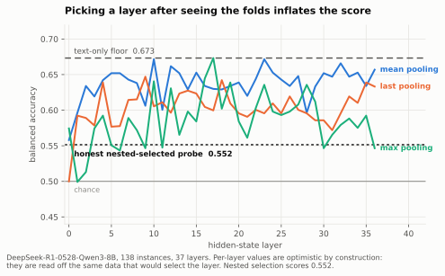
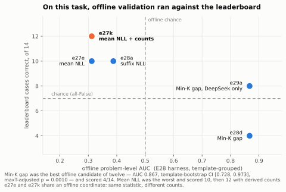
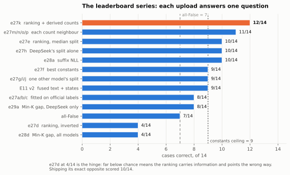
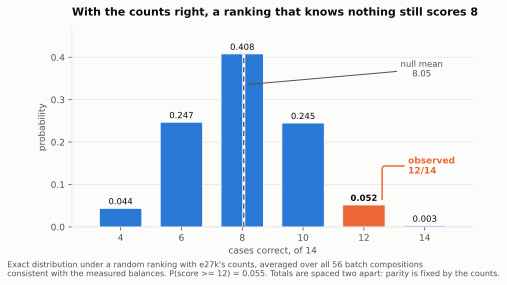

# Predicting Reasoning Robustness Without Training Data

### A record of the AIMO Interpretability Challenge, Small Models Track

**Farhan Ishraq**¹ · *[co-author names to be filled in — see `README.md`]*

¹ Correspondence: farhanishraq2003@gmail.com · Code:
<https://github.com/farhanishraq17/AIMO-Interpretability-Challenge-SMALL---Team-BakeNekos>

**Draft — 14 October 2026.** Every number here is regenerable from the repository; the
commands are in §14. Findings are cited as `F-n` (`PROGRESS.md`). Where this draft and a
`RESULTS.md` table disagree, the table is right.

---

## Abstract

The AIMO Interpretability Challenge asks a question that sounds like classification and is not:
given a model and a problem, will that model's answer survive perturbations that leave the
mathematics unchanged? We ran more than forty experiments over seven weeks, spending well over 300
GPU-hours on a shared free-tier fleet. **Almost all of them failed**, and
the failures are the substance of this report: sixteen rejected hypotheses over twelve distinct signals — hidden-state probes,
reasoning-trace uncertainty, answer agreement under rewriting, self-generated perturbation labels,
activation geometry, contamination statistics — either sat at chance or reversed sign when moved
to an independent population.

We make four claims. **First**, what survived has **no learned parameters at all**: one forward
pass per problem, rank the batch by the scoring model's own mean token negative log-likelihood,
call the more familiar half robust, with the count per model fixed by a closed-form identity rather
than fitted. The ranking is a property of the problem rather than of the model scoring it — four
checkpoints from four families agree at Spearman 0.82 — so the only model-specific quantity in the
method is four integers measured from the evaluation distribution. It scores **12/14 = 0.857** on
the hidden validation set, above the 0.79 that led the board when we started; solved exactly from
our own submissions, its only two misses are one swapped pair inside one model's batch. **Second**,
nothing transferred from our labelled MATH data to the olympiad distribution the competition scores,
and we can say why twice over. In mechanism: the two label sources are decided by different
perturbation families — domain rewording on MATH, where it breaks 86% of solved rows, and on
olympiad problems a single added premise that contradicts the rest, which the models answer straight
through (one of the two we tested flagged it in 0 of 274 samples). In power: the lanes we closed
needed 63 to 320 labelled rows and had 33 to 61, so power ran 14% to 53% and the experiments could
not have returned a positive result even had their hypotheses been true. **Third**, offline validation was *anti-correlated* with leaderboard
behaviour — the candidate with the best offline credentials (AUC 0.867, maxT p = 0.0010) scored
4/14, while the one that failed its offline gate scored 12/14. **Fourth**, two of the eight method
families we pursued could not have been submitted at any accuracy, missing the 3,600-second
whole-run budget by 10× and 11×, where ours runs in **334 seconds for four models**; the gate that
catches this is one multiplication and we never applied it.

We argued in advance that on a 14-case board where scores are multiples of 1/14, leaderboard
position would saturate; four days later three teams were tied at the top. When a public board
saturates, the private test set, the competition's runtime tie-break and the writeup criteria
decide the outcome instead. We therefore treat generalization and efficiency as the primary
objects of study, and report our method's failure modes as carefully as its successes.

---

## 1. The task

### 1.1 Formal statement

A submission implements

```
are_robust(model_id: str, problems: list[str], reasoning_effort: str = "default") -> list[bool]
```

Write `M` for the set of evaluated models and `P` for a batch of problem statements. The function
computes `f: M × P^n → {0,1}^n`, one native Python `bool` per problem, in order.

The label it predicts is **not** whether the model answers correctly. For a (model, problem) pair,
the organizers generate perturbed variants in families
`Φ = {rephrase, rename, domain, distract, typos, expert_perturbations, expert_no_solution}`,
each answer-preserving except the last. With `a₀` the model's accuracy on the original and `a_φ`
its accuracy on family `φ`, define

```
maxdrop(m, p) = max_{φ ∈ Φ} ( a₀(m, p) − a_φ(m, p) )
```

and the published three-valued rule (`aimo-interp/train-main-v2`, verified with zero violations
over all 82 rows, F-30, F-33):

```
robust      iff  maxdrop ≤ 0.10
spurious    iff  maxdrop ≥ 0.25
unlabelled  otherwise            — band cases are never scored
```

Eligibility requires `a₀ = 1.0`: a model that cannot solve the original has no robustness to
measure.

### 1.2 What makes it hard

Three properties, each of which defeated a standard approach.

**The label is a property of the problem, not the pair.** Wherever two of the four evaluated models
are labelled on the same official problem, they agree: **20 of 20 pairs**, label-permutation
p = 0.0005, against a chance agreement rate of 0.608 (F-38). So the model-specific white-box
machinery the competition invites is, empirically, aimed at variance that barely exists.

**Labels are almost absent.** The only in-population labelled data is 82 rows over 36 problems, of
which 71 carry a label. Everything else available is Hendrycks MATH, a different distribution, and
**nothing transferred across that gap** (§6.2). Our largest single finding is that the project was
label-bound from beginning to end, and no amount of compute we had access to could fix it.

That claim is quantified in F-72, because otherwise it is unfalsifiable. For each effect we
actually observed, the rows needed to detect an effect that size at 80% power are **63, 127 and
320**; we had 33 to 61, and power at those sizes ran **14% to 53%**. The experiments were therefore
not capable of returning a positive result even if their hypotheses were true, which means the
uniform nulls of §6 are substantially measuring the sample size. The converse is equally true and
we state it in both places: an effect estimated at n = 33 is estimated badly in both directions,
so the honest reading is *we do not know*, not *we were nearly right*.

**Evaluation is one hour, once.** A single RTX PRO 6000 (96 GB), 3600 s for the *whole* run
covering every model and every problem, no network, no installs, weights only from a read-only
cache. This is not a training-time constraint that scale can relax; it is a hard bound on what any
method may do per problem at test time.

### 1.3 Why generalization and efficiency are the objects of study

The hidden validation set has 14 cases (F-27, F-45). Every score is therefore a multiple of 1/14,
and the ladder from chance to ceiling has roughly seven rungs. We reached 12/14; the constants
ceiling is 9/14; several teams sat at 11/14.

**We predicted the board would saturate, and within four days it did.** On 30 September the public
Small Models Track leaderboard showed **three teams tied at 86%** — 12 of 14 — separated only by
submission timestamp. The structure makes this close to inevitable: for any fixed per-model count
vector the achievable totals are spaced two apart (§7.2), so 12/14 is not one rung below a
continuum of better scores, it is one rung below **14/14, a perfect ranking on every case**. There
is nowhere to go but perfect.

On 12 October another team reached **13/14**. That does not contradict the argument: an odd total is
unreachable for any policy that calls each model's exact robust count, so it comes from a different
count vector, and it is still one case on a set the private ranking does not use. The organizers
said in advance that the final ordering *"will depend on a new set of problems and variants"*
(`getting-started` issue #7), and the website labels the live board "not final results". §7.2 shows
exactly which two of our fourteen calls are wrong.

When a public board saturates, three things decide the outcome, and none of them is leaderboard
position:

1. the **private test set** — 30 unseen problems, where a method that fitted the validation set
   will not follow;
2. the competition's tie-break — *"ties broken by efficiency: faster average runtime over three
   repeated trials"*;
3. the **$5,000 writeup pool**, awarded on generalization, actionable interpretability, negative
   results and efficient methods.

That is the argument for the rest of this report. A method with no fitted parameters cannot fail to
transfer in the way a fitted one can (§9); a method that never generates a token is hard to beat on
runtime (§10); and sixteen documented negative results are worth more in a writeup than one more
case on a board the prizes do not use.

We therefore state what we claim up front:

1. **A training-free predictor.** One forward pass per problem, no fitted estimator, no training
   data, and per-model counts derived in closed form from a measured class balance rather than
   tuned. Its only model-specific quantity is four integers. §4, §9.
2. **Nothing transfers, and we can say why.** Sixteen rejected hypotheses, several with
   independent-population confirmations; a mechanism — the MATH and olympiad labels are decided by
   different perturbation families, and on the olympiad one the models answer through an impossible
   premise; and a power analysis saying the nulls are substantially measuring sample size, stated
   together with what that does *not* excuse. §6.
3. **Offline validation was anti-correlated with held-out behaviour.** The best offline candidate
   scored 4/14; the one that failed its offline gate scored 12/14. We report it as an observation,
   not a theory, and it is why we stopped selecting methods offline. §6.8.
4. **Two method families could never have shipped.** Costed consistently, they miss the whole-run
   budget by 10× and 11×. The gate that catches this needs no GPU, no data and no labels. §10.

---

## 2. Setting

| | |
| --- | --- |
| Competition | AIMO Interpretability Challenge, NeurIPS 2026, Fields Model Initiative |
| Scoring | Codabench competition 16180; 10 submissions/day, 300 total |
| Track | **Small Models** (open weights < 10B) |
| Evaluated models | `Qwen/Qwen3.5-4B`, `Skywork/Skywork-OR1-Math-7B`, `allenai/Olmo-3-7B-Think`, `deepseek-ai/DeepSeek-R1-0528-Qwen3-8B` |
| Evaluation hardware | 1× RTX PRO 6000 (Blackwell, sm_120), 96 GB, 3600 s, offline |
| Our hardware | Kaggle free tier: T4×2, 2 sessions and 30 GPU-h per week per account, ~11 accounts shared with other projects |
| Local hardware | RTX 3050 6 GB — cannot hold any target model; used for data work, CPU training and packaging |

The asymmetry between evaluation hardware and our hardware shaped everything. Generation on T4s is
slow enough that any generation-heavy method was unaffordable to *develop*, independently of
whether it would be affordable to *run*: E14's 3.86M generated tokens took 10.1 GPU-hours (F-24).

---

## 3. Data, and the archaeology it required

### 3.1 What exists

| Source | Content | Role |
| --- | --- | --- |
| `aimo-interp/train-main-v2` | 82 rows, 36 olympiad problems, 5 models, `maxdrop` labels | The only in-population labels |
| `aimo-interp/val-sample` | 28 public validation rows, mixed models | Packaging check only — 1 small-track case |
| `aimo-interp/augmented-sample-math-agg` | Hendrycks MATH, aggregated, for `qwen3-8b:low` | The uncertainty baseline's training set |
| `aimo-interp-challenge-sample-full` | 10 AIMO reference problems (`aimo-2025-reference`) × 8 systems, per-family results, **and the official perturbed texts** (453 variants) | The only per-family evidence on olympiad problems (§6.2) |
| `BeyondHsueh/ReliableMath` | 75 AMC 2023 problems with integer answers and 164 human-checked contradiction rewrites (CC-BY-4.0) | The deciding family, measured on our models (§6.9) |
| `aimo-interp/problems-public` | Symbolic chains | **Private. Will not be shared** (F-59) |
| Our olympiad pool | 505 problems with integer answers: OlympiadBench 362, AMC 83, AIME-2024 30, AIME-2026 30 | Unlabelled; the population the test set is drawn from |

### 3.2 Three data traps, each of which cost real time

**The label rule had to be recovered, and then it changed.** The older public tables key on
`absolute_accuracy_decay`; `train-main-v2` keys on the three-valued `maxdrop` rule above. They are
different rules for different tables, and merging them corrupted two DeepSeek labels before we
noticed (F-44). The fix is a precedence rule: wherever the official split covers a pair, it
decides, and the two rules are never aggregated for the same pair.

**Problem text is not a safe grouping key.** `train-main-v2` repeats the same template with one
constant swapped — `$10^{5}$` against `$10^{4}$`, `f(3520)` against `f(2024)` — under *different*
labels: 36 distinct strings over 29 templates (F-34). Grouping folds by a hash of the text leaks a
near-duplicate across the split. Everything downstream groups by template.

**`AutoTokenizer` silently destroys the input.** Under transformers 5.13, loading DeepSeek's
tokenizer through `AutoTokenizer` strips all whitespace from the problem, so
`"Find the answer \boxed{204}."` round-trips to `""` (F-14). This affects the organizers' own
baseline. Every pipeline now loads through a guard that refuses a tokenizer failing a round trip,
and that guard raises `SystemExit`, which a bare `except Exception` does not catch — a detail that
would have ended an evaluation run.

### 3.3 The permission question, answered

The proposal paper forbade extra labelled data for the official perturbation types. The website
retired that restriction on 19 September, and on 26 September the organizers confirmed directly
that generating additional training data from `train-main-v2` is allowed, that the official labels
are final bar a couple of Skywork rows, and that `problems-public` is private and will never be
shared (F-59). The last point killed an entire planned lane.

---

## 4. Method

### 4.1 The predictor

Let `m` be the model being scored and `P = (p₁ … pₙ)` the batch. For each problem, take **one
forward pass** over the bare problem text and record the mean token negative log-likelihood:

```
s_i = − (1/|t(p_i)|) Σ_k log P_m( t_k | t_{<k} ),      t(p_i) = tokens of p_i
```

No generation, no chat template, no system prompt, truncation at 2048 tokens (which never fires:
the longest labelled problem is 641 tokens). Rank ascending — **familiar first** — and call the
first `c_m` problems robust:

```
π = argsort(s),        ŷ_{π_j} = 1  iff  j ≤ c_m
```

### 4.2 The count, in closed form

This is the part that is derived rather than tuned, and it is the paper's main methodological
claim.

For model `m` on the hidden set, let `r_m` and `q_m` be its robust and spurious case counts,
`n_m = r_m + q_m` its batch size, and `d_m = r_m − q_m` its **class balance**. Constant-prediction
probes measure `d_m` directly: with all-False scoring `a` cases, a probe answering `True` for model
`m` alone scores `a + d_m`, because it gains `r_m` and loses `q_m`. Measured twice, twelve days
apart (F-27, F-64):

| Model | all-False | probe | `d_m` |
| --- | --- | --- | --- |
| Qwen3.5-4B | 7/14 | 8/14 | **+1** |
| DeepSeek-R1-0528-Qwen3-8B | 7/14 | 8/14 | **+1** |
| Skywork-OR1-Math-7B | 7/14 | 6/14 | **−1** |
| Olmo-3-7B-Think | 7/14 | 6/14 | **−1** |

A ranking policy should call exactly `r_m` problems robust — any other count is wrong before the
ranking is even consulted. From the definitions, `r_m = (n_m + d_m)/2`. The four balances sum to 0
and the batch sizes sum to 14, which forces **every `n_m` to be odd**, so `⌈n_m/2⌉ = (n_m+1)/2` and

```
c_m = r_m = (n_m + d_m)/2 = ⌈n_m/2⌉ + (d_m − 1)/2
```

giving the tilt as a closed form of the measured balance:

```
t_m = (d_m − 1) / 2        →   t = 0 for d = +1,   t = −1 for d = −1
```

**The per-model counts are not hyperparameters.** They are the arithmetic consequence of a
measurement, correct for *any* batch sizes consistent with that measurement. Enumerating all 56
size assignments consistent with the balances and the 14-case total: this rule calls exactly the
true robust count in **56 of 56**, and the plain median split in **0 of 56** (F-63).

### 4.3 The algorithm, complete

```
are_robust(m, P):
    if m not in SPLIT_MODELS:        return [CONSTANT[m]] * |P|
    try:
        s   ← one forward pass per p ∈ P under model m        # no generation
        π   ← argsort(s)                                      # ascending: familiar first
        c   ← clamp( ceil(|P|/2) + t_m , 0, |P| )
        return [ j ≤ c for j in rank(π) ]
    except (Exception, SystemExit):                           # tokenizer guard raises SystemExit
        return [CONSTANT[m]] * |P|
```

`CONSTANT[m] = (d_m > 0)`, the best constant for that model. The fallback is not decoration: it is
what keeps a batch valid if weights are missing, a tokenizer fails its round-trip guard, or the
worker OOMs, and an invalid batch scores zero with no visible traceback.

### 4.4 Learned parameters: none

The shipped artifact is 3.3 KB of source and contains **no fitted estimator, no training data, no
weights**. Its only free quantities are the four balances, and those are measurements of the
evaluation distribution rather than parameters fitted to features. This matters for §9.

---

## 5. Experimental programme

More than forty experiments in eight lanes. Full registry in `experiments.md`; what follows is
what each lane was *for*, and what it returned.

| Lane | Question | Experiments | Verdict |
| --- | --- | --- | --- |
| A — text | Is the problem text alone predictive? | E0, E0b | Yes on MATH (0.673 balanced accuracy), no on olympiad |
| B — white box | Do internals carry robustness? | E1, E1b, E4, E30, E31, E32 | AUC up to 0.749 in-distribution; every controlled transfer fails |
| C — traces | Does the reasoning trace carry it? | E2, E2f, E14, E36 | At chance, and 28k tokens per problem |
| D — self-labelling | Can we make our own labels? | E7, E15–E20, E24 | κ = −0.135 on MATH, +0.286 on olympiad, neither usable |
| E — familiarity | Does contamination predict brittleness? | E12, E23, E27, E28, E29 | Fails offline gates, **wins on the leaderboard** |
| F — external | Do other robustness datasets transfer? | E34, E35, E37, E38, E49 | Real labels found; ranking does not transfer; runtime gate fails, then the official-row gate |
| G — arithmetic | What do the leaderboard numbers force? | Probes, E40, E41, E50 | The decisive lane, and the cheapest; it ends by solving the hidden set |
| H — mechanism | What decides a label, and do our models show it? | E51, E52, E52b | An impossible added premise decides olympiad labels; the models answer through it |

---

## 6. What failed

This section is the point of the report. Each entry states the hypothesis, the strongest result it
ever produced, and the test that killed it. The `Script` column names the file in `train/` that
reproduces it, so the negative results are held to the same reproducibility standard as the
positive one; the one refit that was never scripted says so.

A negative result is only worth reading if it is strong enough to have been a positive one. The
column that matters below is **"best result"** — several of these reached AUC 0.73–0.87 before the
test that rejected them, which is why they were pursued and why reporting them is not the same as
reporting things that never worked.

| # | Hypothesis | Best result it reached | What rejected it | Script | § |
| --- | --- | --- | --- | --- | --- |
| 1 | Linear probes on hidden states predict robustness | 58.37% as published; AUC 0.75–0.85 inner-fold | Nested selection gives **0.5005**; the gap is layer selection | `train_stagea_probes.py` | 6.1 |
| 2 | A model trained on MATH transfers to olympiad problems | 0.717 balanced acc in-distribution | **AUC 0.429** on olympiad rows | `eval_official_holdout.py` | 6.2 |
| 3 | Training the text block on olympiad labels instead rescues it | — | No; n = 33 is the binding limit | none recorded (F-40) | 6.2 |
| 4 | Self-labelling on MATH reproduces official labels | — | Cohen's **κ = −0.135**, worse than chance | `compare_selflabels.py` | 6.3 |
| 5 | Self-labelling on *olympiad* problems does | κ = +0.286, sign flipped | CI spans 0; **~1 label per GPU-hour** | `compare_selflabels.py` | 6.3 |
| 6 | Answer agreement under rewriting predicts robustness | — | Chance (0.507), at **28k tokens/problem** | `eval_agreement.py` | 6.4 |
| 7 | Reasoning-trace uncertainty features predict it | — | Near chance; trace states buy AUC but cost a full generation | `train_stageb_features.py`, `train_fusion.py` | 6.4 |
| 8 | Architecture-invariant activation geometry | Family-wise selected signal | **Reverses sign** on independent MATH data | `eval_e30_geometry.py` | 6.5 |
| 9 | Counterfactual prompt-state sensitivity | **AUC 0.735**, the strongest new signal found | Template CI and max-T fail; independent population gives 0.545, CI [0.428, 0.658] | `eval_e31_counterfactual.py`, `eval_e32_counterfactual_math.py` | 6.5 |
| 10 | External robustness labels support a transferring model | Real labels, 233 configurations | Putnam holdout AUC 0.609, CI [0.442, 0.769] | `eval_e35_external.py` | 6.6 |
| 11 | Budget-path reasoning diagnostics | Ranking gates passed; GSM-Plus confirmation passed | **Runtime gate**: 7,526 s for the two models that completed, against a frozen 3,000 s limit | `eval_e36_budget_path.py`, `report_e37_runtime.py` | 6.6 |
| 12 | Min-K tail shape, the best offline candidate of twelve | **AUC 0.867**, CI [0.728, 0.973], maxT p = 0.0010 | **4/14 on the leaderboard** | `eval_e28_stability.py` | 6.8 |
| 13 | Publication status explains the direction reversal | — | Both halves reverse (AUC 0.417, 0.299) instead of straddling 0.5 | `eval_published_split.py` | 6.7 |
| 14 | The reversal survives a sharper instrument | Spearman **+0.247**, sign consistent in every model | Every CI spans zero | `eval_maxdrop_continuous.py` | 6.7 |
| 15 | Budget-path score, re-extracted on the evaluation path, ranks the official rows | Problem AUC **0.659**, passing its gate | Half-rank balanced accuracy **0.521** against a pre-registered > 0.55 | `eval_e49_official.py` | 6.6 |
| 16 | One forward pass predicts which problems a model answers an impossible premise on | — | **No positive class**: Qwen flagged 2 of 130 rewrite samples, Skywork 0 of 274 | `eval_e52.py` | 6.9 |

Entries 13 and 14 are the last two attempts on the reversal, and §6.7 reports why they could
not have succeeded. Entry 12 is the one we cannot explain at all, and §6.8 treats it separately.
Entry 16 is the one that explains the most, and §6.9 reports it.

### 6.1 The shipped baseline is at chance

The organizers' `trained-probe` solution reports 58.37% ± 7.5 on DeepSeek. Reproduced honestly
under nested cross-validation, its per-layer mean balanced accuracy is **0.5005** (F-2, F-11). The
published figure is a **layer-selection artifact**: choosing the best layer on the same data that
scores it inflates inner-fold AUC of 0.75–0.85 down to 0.640 held out. Averaging every layer,
rather than selecting one, is a genuine lead at AUC 0.749 — but see §6.2.



**Figure 1.** Every individual layer scores well above the honestly nested probe, and several beat the text-only floor. That gap is the artifact: per-layer values are read off the same data that would select the layer. Nested selection — choosing the layer inside each fold — scores 0.552. DeepSeek-R1-0528-Qwen3-8B, 138 instances, 37 layers.


**This is the single most useful thing a newcomer to this competition can know**, and it applies to
anyone who takes the baseline's number at face value.

### 6.2 Nothing transfers from MATH to olympiad problems

Our labelled data is overwhelmingly Hendrycks MATH; the private test set is entirely olympiad. Every
block was measured across that gap and every one failed (F-32, F-39, F-40):

| Block | In-distribution | On olympiad rows |
| --- | --- | --- |
| Text (char tf-idf) | 0.673 balanced acc | AUC 0.617, CI spans 0.5 |
| Stage A prompt states | AUC 0.749 | AUC 0.429 |
| E11 fused, shipped | 0.717 balanced acc | 0.429 |
| Cross-model probe | — | no held-out model clears chance |

Training the text block *on* olympiad labels instead does not rescue it (F-40). There is no version
of this that works at n = 33.

**Why, in one table** (F-76). A label is spurious when *any* family costs 25 points, so the question
is which family does that, population by population. On rows where the model had solved the
original, the share where each family dropped accuracy by 0.25 or more:

| Population | The family that breaks it | Surface families (rephrase, rename, typos) |
| --- | --- | --- |
| DeepSeek, Hendrycks MATH (all our training labels) | **domain 0.86**, distract 0.33 | 0.02–0.10 |
| Organizers' olympiad sample, 8 systems | **`expert_no_solution` 0.43** | 0.03 each |
| DeepSeek alone, olympiad sample | **`expert_no_solution` 0.33** | 0.00 |

`expert_no_solution` adds one premise that contradicts the rest — in the organizers' own example,
*"the system registers a cumulative total of at least 21.0 individual departures"* where at most 15
are possible — so the right answer is that none exists. It sets `maxdrop` on 10 of the 18 spurious
pairs in that sample. Every model we trained on MATH therefore learned *"breaks when the story moves
to another domain"*, a family that does not break a single eligible olympiad row in the organizers'
sample. The transfer failures in the table above are what that predicts. The caveat is size: the
per-family table rests on 7 eligible problems, and the official splits publish no families at all.

### 6.3 Self-labelling: two attempts, both rejected

If labels are the bottleneck, make labels. We sampled models on originals and on perturbed
variants and applied the official rule. Twice.

- **On MATH problems (E20):** Cohen's κ = **−0.135** against official labels, drops correlated
  −0.25. Worse than chance. Lane closed (F-31).
- **On olympiad problems (E24), after arguing the population was the problem:** κ = **+0.286**,
  bootstrap CI spanning 0, on 15 usable pairs — for **15.8 GPU-hours**, about one label per GPU-hour
  (F-48). The sign flipped, which is real evidence the population mattered, and the yield made the
  lane unaffordable anyway.

The deeper issue: our perturbation family (`answer_modulus`) is not one of the official seven. It
changes what is asked, so it measures a different quantity. §6.2's table makes that sharper than we
knew when we ran these: on olympiad problems the family that decides the label is
`expert_no_solution`, and neither attempt generated anything like it. §6.9 measures that family
directly.

### 6.4 Test-time methods are unaffordable, and the signal is in the prompt

**Answer agreement under rewriting (E14).** Hypothesis: a robust model gives the same answer when
the problem is reworded. Result: balanced accuracy 0.507, AUC 0.497 — chance — at **28,000 generated
tokens per problem** (F-24). Both halves of that sentence independently disqualify it.

**Reasoning-trace uncertainty (E2f), and what trace states actually did.** The published 14
uncertainty features are near chance on our data (F-15). Trace *states* (E4) are a more careful
test, and the result is more interesting than a null: adding them to the text + prompt-state fusion
moves AUC 0.7230 → 0.7391 and balanced accuracy 0.7173 → 0.7116 (F-18) — a gain on one metric, a
loss of 0.006 on the other, with overlapping intervals.

We rejected them on **cost, not on signal**: they need a full generated trace at inference, minutes
per problem against one forward pass. And within E4 the ordering is diagnostic — `prompt_last`
pooling scores AUC 0.7386 while `trace_last` scores 0.6040, and the nested selector chose
`prompt_last` in 4 of 5 folds. **States late in the reasoning are the weakest**, the opposite of the
hypothesis E4 was built to test. The signal is in the prompt, not in the trace.

### 6.5 Activation geometry: attractive, and an artifact

Two related lanes produced the project's most seductive numbers.

**E30, architecture-invariant geometry.** Family-wise test fails; the selected signal *reverses* on
independent MATH data (F-51).

**E31, counterfactual prompt-state sensitivity** — measure how far a problem's representation moves
under an answer-preserving rewrite. Best AUC **0.735** on official data, the strongest new signal we
found. It failed its template-cluster CI and its max-T test, and Qwen sat near chance (F-52). E32
then scored it on an independent DeepSeek MATH population: **AUC 0.545, CI [0.428, 0.658]** (F-53).
Lane closed.

The pattern repeats often enough to name: **a signal selected on 29 template clusters will reach
AUC 0.7–0.8 and will not survive an independent population.**

### 6.6 External datasets: labels exist, ranking does not transfer

E35 found genuine external robustness labels (MATH-Perturb as training source, Putnam-AXIOM as an
untouched holdout, 233 labelled configurations). Problem-text ranking did not transfer across the
source boundary. E36 tried the reasoning *path* at four token budgets; its ranking gates passed
strongly but its frozen absolute-threshold gate missed by 0.0025, so it formally failed. E37, the
one pre-registered confirmation, **passed its GSM-Plus confirmation and then failed its runtime
gate**. That gate was the protocol's frozen **3,000-second** end-to-end limit, set below the
competition's 3,600 s budget: feature extraction took 5,293 s for Qwen alone and **7,526 s for the
two models that completed**, with DeepSeek's guard stopping it at two hours. E38's exact-prefix
audit failed every comparison.

That runtime figure was measured with at most two sequences in flight under vLLM, which the
evaluation image does not ship, so E49 gave the signal a fair second test: E37's frozen predictor,
re-extracted with batched `transformers` generation — the only engine a submission can use — and
scored once on all 34 official rows under a new pre-registration (F-74). It passed its problem-level
gate (AUC **0.659**) and failed its decision gate: half-rank balanced accuracy **0.521** against
> 0.55. On the same rows it out-ranks the shipped familiarity ranking (row AUC 0.571 against 0.358),
and neither reaches always-robust's 0.706, which no half split on a 71%-robust set can.

### 6.7 Why the last two attempts could not have worked

The direction reversal of §11.1 is the project's one unexplained result, and it was attacked twice
more after the rest of this section was written.

**Publication status does not explain it** (F-69). Eight of the 36 official problems appear
verbatim in our pinned olympiad pool, a publication indicator decided by text match with no
reference to any model or label. The memorisation hypothesis predicts the two halves straddle
chance. They do not: AUC **0.417** on the mirrored problems and **0.299** on the rest, both
reversed, and the mirrored half — the one that should be most memorisation-driven — is the *less*
reversed of the two.

**A sharper instrument does not rescue it either** (F-70). Scored against `max_drop` directly
rather than the binarised label, familiarity correlates **+0.247**, positive in every model and
every subset, and **+0.225 within length deciles** so it is not the length artifact that drives
every text statistic here. Every interval still spans zero.

**Both results are about sample size, and we can say by how much** (F-72). Detecting a correlation
of +0.247 at 80% power needs **127 rows**; we have 37. Across the three lanes tested this way, the
requirement is 63 to 320 rows against the 33 to 61 we hold, and power at the sizes actually run was
**14% to 53%**. The experiments were not capable of returning a positive result even if their
hypotheses were true, which is why the nulls in this section are so uniform.

The converse deserves equal weight and is easy to drop: low power does not make the observed
effects real. An effect estimated at n = 33 is estimated badly in *both* directions — the same
arithmetic that says we could not detect +0.247 says we could not distinguish it from +0.6 or from
zero. **The honest reading of this section is that we do not know, not that we were nearly right.**

### 6.8 The offline/online inversion

The most uncomfortable result in the project, and the one we cannot explain.

| | Offline verdict | Leaderboard |
| --- | --- | --- |
| Official-label models (`e27a/b/c`) | Best available offline fit | **8/14** |
| Min-K gap (`e28d`) | Passes a *stricter* stability gate than the winner: rank AUC 0.808, worst-case omission 0.65 | **4/14** |
| DeepSeek-only Min-K (`e29a`) | Controlled follow-up | **8/14** |
| Mean-NLL familiarity (`e27e`) | **Fails** gate G-M offline | **10/14** |
| The same, with derived counts (`e27k`) | Fails the same gate | **12/14** |

**On this task, offline validation was anti-correlated with leaderboard behaviour.** The two
methods with the best offline credentials scored 4/14 and 8/14; the method that failed its offline
gate scored 12/14.



**Figure 4.** Offline problem-level AUC (E28 harness, template-grouped) against cases correct on the hidden set, for every candidate submitted with both measurements. Min-K gap was the best of twelve candidates offline — AUC 0.867, template-bootstrap CI [0.728, 0.973], maxT-adjusted p = 0.0010 — and scored 4/14. Mean NLL was among the worst offline and scored 10, then 12 once its counts were derived. `e27e` and `e27k` share an x-coordinate: the same statistic, different counts.
 We report this as an observation rather than a theory. It is the strongest
practical reason we stopped selecting methods offline and started reasoning about the evaluation
distribution's arithmetic directly (§7).

### 6.9 The family that decides the label: the models answer through an impossible premise

§6.2 located the family that decides olympiad labels. E52 measured it on our own models, from
public data and under a pre-registration fixed before any record existed (F-77). ReliableMath
(Xue et al., 2025) pairs 75 AMC 2023 problems with 164 human-checked rewrites that each add a
contradictory condition. We sampled Qwen3.5-4B and Skywork-OR1-Math-7B on originals and rewrites
with the organizers' decoding — temperature 1.0, top-k 40, top-p 0.95 — at k = 2 and a 16k-token
cap. A rewrite sample counted as *detected* only if it finished, gave no integer answer, and said
there was none; a hand audit of 30 random samples agreed with that grader 30 of 30.

| | Qwen3.5-4B | Skywork-OR1-Math-7B |
| --- | --- | --- |
| Base samples correct / out of budget | 62 / 150 and **89 / 150** | 130 / 150 and 17 / 150 |
| Rewrite samples: answered / out of budget / flagged | 23 / **103** / 2 | **217** / 52 / **0** |
| Answered with the *original* problem's answer | 9.2% | **43.8%** |

**Skywork never flagged the contradiction**, in 274 samples. It finished and answered, and 44% of
its answers were exactly the answer to the problem *before* the premise was added — answering from
the pattern rather than the premises, which is precisely what the family probes for. **Qwen
reasoned instead of answering.** 79% of its rewrite samples, and even 59% of its samples on the
unaltered problems, ran out of the 16k budget; several truncated traces had already noticed the
clash and were still weighing it. The organizers sample to 100k tokens, where Qwen would finish
more often; this run cannot say how often it would then abstain.

**The pre-registered gate failed without a test.** It asked whether one forward pass on the
original predicts which problems a model handles, but no eligible pair reached the robust-like
threshold, so there was no positive class to predict. One grader error surfaced after the audit — a
Qwen sample that answered 2.4 while remarking that the dimensions were "physically impossible" —
and is reported rather than patched; no decision depends on it.

Two things follow. **For the submission**, the result gives the Skywork tilt of §4.2 a mechanism
where it previously had only a balance: on the family that decides labels, Skywork is the model
that answers through the trap (§9). **For the field**, the competition's label is substantially a
measure of whether a model checks its premises, which none of the representation-reading methods
in this report was aimed at. The reasoning-length behaviour matches the missing-premise
"overthinking" reported by Fan et al. (2025).

A follow-up on Olmo-3-7B-Think (E52b) could not run at these settings on our hardware: vLLM 0.20
sized its cache as full attention on all 32 layers, 20,288 tokens on a T4 pair, and two 16k samples
of one problem need about 33k, so every session died before reaching a rewrite (F-78). The Olmo tilt
therefore rests on its measured balance alone.

---

## 7. What worked

### 7.1 The leaderboard series

Twenty-two submissions, each designed to answer one question rather than to climb.

| Score | | Submission | What it established |
| --- | --- | --- | --- |
| **0.86** | 12/14 | `e27k` | Ranking + derived counts. **The incumbent** |
| 0.79 | 11/14 | `e27m/n/o/p` | Every single-step neighbour of `e27k` loses exactly one case |
| 0.71 | 10/14 | `e27e` | The ranking alone, median split |
| 0.71 | 10/14 | `e27h` | DeepSeek's split alone — **the whole gain is one model's** |
| 0.71 | 10/14 | `e28a` | Suffix NLL ties: the familiarity *family* works, not one statistic |
| 0.64 | 9/14 | `e27f` | **The constants ceiling** |
| 0.64 | 9/14 | `e27g/i/j` | Splitting Qwen, Skywork or Olmo alone adds nothing |
| 0.57 | 8/14 | `e27a/b/c`, `e29a` | Offline-fitted models carry nothing |
| 0.50 | 7/14 | all-False | 7 of 14 cases are spurious |
| 0.29 | 4/14 | `e27d`, `e28d` | Far below chance ⇒ the ranking is real and inverted |

`e27d` at 4/14 is the hinge of the whole project. A score that far below chance is not noise: it
says the ranking carries information and is pointing the wrong way. Shipping its exact opposite
produced 10/14 the next day.



**Figure 2.** Each upload was designed to answer one question rather than to climb. The two reference lines are the whole strategic picture: nothing below 7 beats answering `False` everywhere, and nothing below 9 beats the best constants, so only the top two rows contain per-problem information.


### 7.2 Why the counts were the real gain

Decomposing `e27k`'s 12: a random ranking with the *same derived counts* scores **8.05/14** in
expectation, against 7/14 for all-False (F-63). So roughly one of the two cases separating `e27k`
from `e27e` is count arithmetic, not ranking quality. The ranking's own contribution puts the
observed 12 at **p = 0.055** under a null of no ranking information — suggestive, not significant,
which is the same verdict every offline test returned, now measured on the hidden set.

| Source of the 12 | Cases | How established |
| --- | --- | --- |
| All-False floor | 7.00 | 7 of 14 cases are spurious |
| Correct per-model counts, random ranking | 8.05 | Null averaged over all 56 consistent compositions |
| Observed, with the familiarity ranking | 12 | P(score ≥ 12) = 0.055 under that null |

A structural detail worth carrying: for a fixed count vector the achievable totals are **spaced two
apart**, because parity is fixed by the sum of robust calls. `e27k` can score 10, 12 or 14 and never
11 or 13. Two cases is the minimum observable difference, not a margin.

**The hidden set, solved** (F-75). The 56-way average above exists because the probes fix each
model's balance but not its batch size. Every submission in §7.1 is a deterministic function of one
per-model ranking, though, so each score is another equation in the same unknowns. Enumerating every
assignment of batch sizes summing to 14 and an R/S label per familiarity rank, and keeping those that
reproduce all 17 recorded scores — no balance or size assumed — leaves **exactly two states**, with
one composition:

| Model | Cases | Robust | Labels, most familiar first | `e27k` correct |
| --- | --- | --- | --- | --- |
| Qwen3.5-4B | 5 | 3 | R S R S R, or S R R S R | 3 of 5 |
| DeepSeek-R1-0528-Qwen3-8B | 3 | 2 | R R S | 3 of 3 |
| Skywork-OR1-Math-7B | 3 | 1 | R S S | 3 of 3 |
| Olmo-3-7B-Think | 3 | 1 | R S S | 3 of 3 |

The probe balances come out of the solve rather than going into it, which checks the whole record
at once. The ranking is perfect on three models; `e27k`'s two misses are one swapped pair inside
Qwen's batch. On this composition the null of the table above gives **P(score ≥ 12) = 0.048**,
against the 0.055 averaged over all 56. We did not submit the swap that would show 14/14: it fits
five known cases, and on new problems it would call Qwen's least familiar problem robust, against
the method's own direction.



**Figure 3.** The exact distribution of the score when the ranking is replaced by chance but the counts are kept, averaged over all 56 batch compositions consistent with the measured balances. Correct counts alone are worth about a case over all-False (8.05 against 7). The observed 12 sits in the 0.052 bar: P(score ≥ 12) = 0.055.


### 7.3 Mechanical audit of the incumbent

Before freezing, we audited the shipped artifact on GPU (E39, F-62):

| | Result |
| --- | --- |
| Runtime, four models, 144 problem-scorings, 4 cold loads | **334 s** on T4×2 |
| Determinism, two identical calls | Identical for all four models |
| Cross-machine replication (separate account, session, host) | **Identical predictions on every arm** |
| fp16 vs bf16 | **0 / 36 predictions flip**, Spearman 0.993–1.000 |
| Chat template vs bare text | 2–10 / 36 flip, Spearman 0.738–0.973 |

Two conclusions. The method is **not precision-sensitive**, which matters because our features were
extracted where T4 bf16 is emulated while evaluation runs bf16 on Blackwell. And the **bare-text
prompt is load-bearing** — scoring the chat template instead is a different policy with no
leaderboard evidence, and it would move several cases. Tidying that "inconsistency" before the
freeze would have been a mistake.

---

## 8. Methodological protocol

The practices below were adopted after they were needed, and each traces to a specific loss.

**Pre-registration.** The population, procedure, metric and pass threshold are frozen in
`protocols/` before the run's output is read. Adopted after §6.1's layer-selection artifact and a
threshold tuned on the 14 cases it was then evaluated on. A gate that fails is a result.

**Template-cluster grouping, never text hashing.** §3.2.

**Independent-population confirmation.** No signal is believed on the population that selected it.
E32 exists solely to re-score E31 elsewhere, and it closed the lane.

**Every number comes from a script.** No figure is hand-typed into a document;
`scripts/regenerate_results.py` rebuilds every table in one command. This is also the competition's
reproducibility requirement.

That mechanism had a defect worth recording, because it is the failure mode of this discipline
rather than an argument against it. The rebuild starts by rewriting the file from scratch, so a
section whose producer is missing from the step list is deleted rather than left stale — and the
command still reports success. On 1 October an audit found **18 of 37 sections** in that state,
accumulated one experiment at a time by authors who upserted a section and never registered it.
Every section — 40 as of this draft — is now covered, and `scripts/check_results_coverage.py` asserts the invariant and fails
when a producer is removed (F-73).

**Two-rule discipline.** The `absolute_accuracy_decay` and `maxdrop` rules are never aggregated for
the same pair (§3.2).

**Contract checks before every upload.** `coverage = 1.0`, `invalid_predictions = 0`, native
`bool`s, and the `small.txt` marker that selects the track — getting it wrong scored 0.00 and cost
four uploads to diagnose (F-21).

---

## 9. Generalization

The competition rewards generalization explicitly. Our claim is narrow and, we think, defensible.

**The shipped method has nothing to overfit.** It contains no fitted estimator and no training
data. Its inputs are the scoring model's own likelihoods — available for any autoregressive model,
any tokenizer, any architecture — and four integers measured from the evaluation distribution. There
is no feature selection step, no layer choice, no threshold tuned on held-out data, because there is
no training step at all. The failure mode that killed lanes B, E-offline and F — *a signal selected
on 29 clusters that reverses on an independent population* — cannot occur, because nothing is
selected.

**It is architecture-agnostic by construction.** The same six lines apply unchanged to any
autoregressive model. We verified identical behaviour across four checkpoints from four different
families, 4B to 8B (E39).

**And the model-specific surface is smaller than it looks.** The policy loads the model being
scored, which implies the ranking is model-specific information. Measured, it is almost not: across
the 193 problems all four models scored, their familiarity rankings agree at mean pairwise Spearman
**0.821**, and **0.748 within length deciles** where length cannot drive it; each model sits 0.893
to 0.957 against the consensus of all four (F-68). The four models rank the same problems in
essentially the same order.

This is the same shape the robustness *label* has (§1.2): a property of the problem, not of the
pair. So the ranking generalizes for the reason problem properties do, and **the only genuinely
model-specific quantity in the method is the robust count** — four integers, measured rather than
fitted. That is a smaller surface to defend than "a per-model likelihood model", and it is the
precise sense in which this method has little to overfit.

It also implies a cheaper variant — rank once, apply per-model counts, a fourfold reduction in
test-time cost — which we did not build. It is a different policy with no leaderboard evidence, the
freeze was close, and F-62 had already shown this family moves under changes that look harmless.
We report it as an implication rather than shipping it.

**Its assumptions are stated and testable.** The method assumes (i) familiar problems are more
robust, and (ii) the per-model balances `d_m` hold. Assumption (ii) is directly measurable for five
submissions, and we re-measured it twelve days later with all four values reproducing exactly
(F-64). Assumption (i) is the contested one — see §11.1.

**What does not generalize, and we say so — with the size of the exposure.** The counts are
measured on the *validation* set; the prizes are scored on a private test set of 30 problems whose
class prior may differ. F-67 quantifies what that costs. A policy calling `c` of `n` robust with an
uninformative ranking scores `c(2r/n − 1) + n − r`, linear in `c`, so lowering `c` by one gains
`1 − 2r/n` cases: **the crossover is a robust share of exactly 0.5, independent of batch size.**

Two consequences. Qwen and DeepSeek have zero tilt, so they contribute nothing whatever their prior
does — **the entire difference between `e27k` and `e27e` rides on two models**. And those two are
the ones our sources disagree about: the validation probes make Skywork and Olmo spurious-leaning,
while the organizers' own labelled split makes both majority robust, at 0.667 and 0.778. If the
private shares matched the official split, the tilts would cost about 0.89 cases rather than gain
roughly one.

So the choice is not "0.86 against 0.71" — that compares scores on the set where `e27k` is right by
construction. It is a **symmetric bet on whether two models stay spurious-leaning**, worth about a
case either way.

One half of that bet now has independent support. On the perturbation family that decides
olympiad labels, Skywork never flagged the contradiction in 274 samples while Qwen stopped to reason
about it
(§6.9, F-77) — the same ordering the validation balances give, reached on a different population by
a different measurement. The Olmo half has no such evidence; the attempt to measure it could not run
on our hardware (F-78). We ship `e27k` because the balances are the only measurement anyone has, and
measured beats assumed; `e27e` is the prior-free alternative and the right choice for anyone who
weights the official split more heavily than the validation set.

---

## 10. Efficiency

Ties break on average runtime over three repeated trials, so this is a scored axis, not a footnote.

| Method | Per-problem cost | Measured |
| --- | --- | --- |
| **Shipped (`e27k`)** | 1 forward pass, ~10² tokens | **334 s / 4 models / 144 scorings**, incl. cold loads |
| Trace uncertainty (E2f) | greedy generation, 4,096 tokens | ~3.3× slower in bf16 than fp16 on T4 |
| Answer agreement (E14) | k rewrites × full generation | **28,000 tokens/problem**; at chance |
| Budget-path features (E36/E37) | 4 token budgets per problem | **5,293 s for one model** — failed its gate |

Three orders of magnitude separate the top and bottom rows. The shipped method never generates a
token: it reads the problem once and returns a number. The dominant cost is loading the checkpoint,
which the harness pays regardless.

Costed consistently — forward passes and generated tokens per problem, converted at rates measured
on our own hardware, over 120 pairs — **two of the methods this project pursued for weeks could not
have been submitted at any accuracy** (F-71). E14 needs ~37,600 s and E36/E37 ~41,200 s against a
3,600 s budget, missing by 10× and 11×; no plausible hardware difference closes that. E2f misses by
2×, which is within the evaluation card's likely speedup, so it is borderline rather than ruled
out.

E14 was abandoned for scoring at chance. Had it shown signal, we would have spent the remaining
weeks on something unshippable. The gate that prevents this is one multiplication — per-pair cost
must not exceed the budget divided by the pair count, about 30 s or 2,700 generated tokens here —
and it needs no GPU, no data and no labels. We never applied it. The underlying ratio generalises
past this competition: any method that generates pays the length of a chain of thought against the
length of a problem statement, on every pair.

---

## 11. Limitations, and the one unresolved contradiction

### 11.1 The contradiction

The shipped direction — **familiar problems are robust** — holds on DeepSeek's 142 MATH instances
and on the hidden validation set repeatedly. It **reverses** on the 34 official olympiad rows, where
the same split scores 0.353 against 0.706 for always-robust (F-58), a result we re-confirmed with
the shipped artifact itself (F-62: agreement 0.22–0.40 against an always-robust floor of 0.67–0.78,
part of which is mechanical, since a median split cannot reproduce a 70%-robust prior).

The hypothesis we could not test: `train-main-v2` holds **published** problems — 2025 AIME I appears
verbatim — where familiarity means memorisation and predicts *spurious*; the validation cases are
mostly not those problems, where familiarity is ordinary fluency and predicts *robust*. The
organizers' own report splits results by published versus unpublished, so the distinction is theirs.

**We have since tested it once, and it got no support** (F-69). Eight of the 36 official problems
appear verbatim in our pinned olympiad pool - a publication indicator decided by text match, with
no reference to any model or label. Splitting on it, familiarity scores AUC 0.417 on the mirrored
problems and 0.299 on the rest: **both below 0.5**, both reversed, and the mirrored half is the
*less* reversed of the two, which is the opposite of what the hypothesis predicts. If publication
status drove the reversal, those two numbers should straddle 0.5.

That is not a refutation. At n = 8 the mirrored interval is [0.000, 0.833], and the indicator is
one-sided: absence from a four-dataset pool is not evidence of being unpublished. But the leading
explanation has now been tested on the only partition the data supports and did not separate. A
clean test needs per-problem publication dates, which nothing available to us has (F-59). **It no longer
decides what we ship** — §4.2's count argument settles `e27k` over `e27e` without reference to the
ranking's direction — but it remains the most interesting open question in the project.

§6.2 now offers a candidate mechanism, untested. If a spurious olympiad label usually means the model
answered through an added contradiction, then a problem the model recognises is exactly one where it
can produce the remembered answer without checking the new premise — Skywork returned the original
problem's answer in 44% of its rewrite samples (§6.9). That predicts *familiar = spurious* wherever
the evaluated problems are well known, and leaves room for the opposite elsewhere. It is the
publication hypothesis again with a mechanism attached, and F-69 has already found no support for
the publication split at n = 34, so we offer it as the next thing to test rather than an
explanation.

### 11.2 Limitations

- **Sample size dominates everything.** Fourteen validation cases, 33 labelled problems, 82 rows.
  Power ran 14% to 53% across the lanes we closed (§6.7). Most of our negative results are
  underpowered, and we say so rather than presenting them as settled.
- **The counts are measured on the validation set, not the test set.** §9 prices the exposure: the
  tilts are a symmetric bet worth about a case either way, and they could cost 0.89 cases if the
  private class shares match the official split instead.
- **One competition is not a general law.** The offline/online inversion (§6.8) is a real
  observation on this task. We cannot say whether it is a property of this task, of 14-case
  evaluation, or of our own gates.
- **We did not pursue sparse autoencoders**, which the Small Models Track was designed to invite.
  At 33 labelled problems a feature search over thousands of sparse features has no statistical
  power, and our template-cluster bootstrap would reject anything it found. A deliberate omission,
  not an oversight.
- **The forward-pass path is verified on separate hardware, not in the competition image.** §14.1
  covers what the container check does and does not establish.
- **The deciding family was measured narrowly.** §6.2's per-family table rests on 7 eligible
  problems, and §6.9 used public AMC rewrites rather than the organizers' expert ones, two of the
  four models, and a 16k cap against their 100k. Its direction is clear; its size on the test set is
  not known.

---

## 12. Related work

Every citation in this section was verified against arXiv or the publisher in October 2026; full
entries with identifiers are in the References. Where a work's arXiv preprint and its venue fall in
different years, the References give both and the text uses the venue year.

**Perturbation robustness in mathematical reasoning.** The competition's premise — that final-answer
accuracy overstates reasoning — is the same one behind *GSM-Symbolic* (Mirzadeh et al., 2024), which
templates GSM8K problems and shows accuracy falling when only surface constants change, and falling
further when an irrelevant clause is added. Our `distract` family is that construction, and the
organizers' `maxdrop` rule is a thresholded version of the same measurement. *MATH-Perturb* (Huang
et al., 2025) and *Putnam-AXIOM* (Gulati et al., 2025) supply the external labels used in E35 —
both are themselves benchmarks built by perturbing competition problems, which is why their labels
were the most plausible external source available. Hendrycks et al.'s *MATH* (2021) is the
distribution our labelled data came from and, per §6.2, the reason it did not transfer.

**Unanswerable problems.** The family that decides olympiad labels, `expert_no_solution`, has its own
literature. *ReliableMath* (Xue et al., 2025) builds unsolvable variants of AIME, AMC, MATH and
Minerva problems by removing a necessary condition or adding a contradictory one, checks them by
hand, and reports that models rarely identify them and usually fabricate an answer; we used its AMC
contradiction rewrites in §6.9. Fan et al. (2025) show that reasoning models think far longer on
problems with a missing premise instead of declining them, which is the out-of-budget behaviour we
saw in Qwen. Neither work connects the behaviour to a robustness label, which is the connection this
competition's rule makes.

**Contamination and membership inference.** Our shipped statistic is a membership-inference score
used for a different purpose. Mean token NLL is the oldest such signal; *Min-K%* (Shi et al., 2023)
averages the lowest-probability tokens, *Min-K%++* (Zhang et al., 2024) normalises it per token, and
the zlib-compression ratio is from Carlini et al.'s training-data extraction work (2021), with the
reference-model calibration from *Membership Inference Attacks From First Principles* (Carlini et
al., 2022). We implemented all of them (E23, E28). The relevant negative result is §6.8: the
statistic with the strongest contamination-detection credentials offline (Min-K gap) was the worst
predictor of robustness on the hidden set, and plain mean NLL was the best.

To our knowledge the *direction* we found — familiar problems being **more** robust on the
evaluation distribution, while familiarity predicts brittleness on published olympiad problems
(§11.1) — is not reported in that literature, which studies contamination as a threat to benchmark
validity rather than as a feature.

**Probing and its selection artifacts.** Linear probing of hidden states follows Alain and Bengio
(2016); Hewitt and Liang's *Designing and Interpreting Probes with Control Tasks* (2019) is the
direct antecedent of §6.1 — a probe's accuracy is uninterpretable without a control for what the
probe itself can fit. Belinkov's probing survey (2022) catalogues the same failure. Our
contribution here is an instance rather than a method: the competition's own published baseline
reports 58.37% where honest nested selection gives 0.5005, and the difference is layer selection.

**Sparse autoencoders.** Feature-level interpretability via SAEs (Cunningham et al., 2023; Bricken
et al., 2023; Templeton et al., 2024) is what the Small Models Track was designed to invite. We did
not pursue it, for the reason given in §11.2.

**Uncertainty and self-consistency.** The organizers' second baseline uses token-level uncertainty
features; the underlying idea traces to Kadavath et al. (2022) on models knowing what they know,
and to semantic-entropy approaches (Kuhn et al., 2023; Farquhar et al., 2024). Self-consistency
(Wang et al., 2023) motivated E14's answer-agreement test. Both were at chance here (§6.4), and
E14's cost — 28,000 generated tokens per problem — is the concrete reason sampling-based
uncertainty is a poor fit for a one-hour whole-run budget.

**Multiple comparisons.** The maxT family-wise adjustment used throughout our gates follows
Westfall and Young's resampling-based procedure (1993). Applying it is what turned several attractive
signals into null results (§6.5).

**Where this work sits.** We contribute no new interpretability *technique*, and that is not the
claim. The claim is methodological and it is unfavourable to the field's usual practice: on this
task, a predictor with no fitted parameters beat every fitted one we built, and the offline metrics
interpretability research routinely selects on were *anti-correlated* with held-out performance
(§6.8). Both are statements about how interpretability methods should be validated, not about a new
way to read a model.

---

## 13. What we would do differently

1. **Probe the evaluation distribution early.** Five constant submissions measure the class balance
   of every model, and that measurement — not any feature — is what produced our best score.
2. **Distrust any offline gate on this task** (§6.8).
3. **Budget tokens, not GPU-hours.** Every sampling failure in this project was a context-length
   failure wearing a compute-budget costume.
4. **Cost the method before testing it for signal.** Per-pair cost must not exceed the budget
   divided by the pair count — here about 30 s, or 2,700 generated tokens. It is one
   multiplication, needs no GPU and no data, and would have rejected two of the eight method
   families outright (§10). We ran them for weeks instead.
5. **Compute the power before running the experiment, not after the null.** At 33 labelled
   problems, most of what we tested could not have reached significance at the effect sizes we
   were hoping for (§6.7). Knowing that in week one would have redirected the whole project toward
   acquiring labels rather than toward testing signals against the labels we had.
6. **Ask what decides the label before modelling it.** The per-family table of §6.2 needed no GPU
   and used a public table that was available from the first day. It shows that our training labels
   and the competition's are decided by different perturbations, which explains weeks of transfer
   failures in one line — and it is the last analysis we ran rather than the first.

---

## 14. Reproducibility

```bash
# Every generated table in the Small Models Track (~25 min)
python scripts/regenerate_results.py

# The leaderboard arithmetic and the null test for 12/14; the hidden set solved (§7.2)
python train/eval_batch_composition.py
python train/eval_hidden_state.py

# What decides a label (§6.2), and the deciding family on our models (§6.9)
python train/eval_label_mechanics.py
python train/eval_e52.py              # needs the e52 runs; protocol in protocols/E52_PROTOCOL.md

# Rebuild every submission ZIP, deterministically
python submission/make_e27.py     # 13 candidates incl. the incumbent
python submission/make_e28.py     # rank successors
python submission/make_probes.py  # the 5 constant probes
```

Repository layout: the Small Models Track folder holds `CLAUDE.md` (conventions), `COMPETITION.md`
(rules), `PLAN.md`, `PROGRESS.md` (numbered findings), `RESULTS.md` (generated — never hand-edited),
`experiments.md` (registry) and `protocols/` (pre-registrations). Submissions are indexed by score
in `submission/README.md`, and the built ZIPs are committed, so the artifact that scored can be
uploaded from a clone without rebuilding. Kernels are exported to `kernels/` exactly as pushed, so
any run can be rebuilt if a Kaggle account disappears. The failure table in §6 names the script
behind each rejected lane.

### 14.1 The shipped artifact, verified in the competition image

The organizers must be able to reproduce the result from this report alone, so the shipped ZIP was
run inside `Dockerfile.competition` itself, with networking disabled (E42, F-65, F-66).

The first run **failed, and both failures were in our test harness rather than the submission** —
an exact-match comparison against `torch.__version__` that could never succeed on a CUDA wheel
reporting `2.12.1+cu132`, and a `small.txt` check that was computed and reported but left out of
the pass expression. Both are fixed. We record this because it is the honest version of a
reproducibility claim: the first independent execution of our own check found bugs in the check.

The corrected script then passed end to end on a **second machine**, from an image rebuilt with
`--no-cache`, exit code 0. The result is committed as `submission/docker_load_test_result.json`
with the provenance that makes it checkable rather than assertable:

| Field | Value |
| --- | --- |
| Base image digest | `sha256:f48553a2…` (as pinned in `Dockerfile.competition`) |
| Dockerfile from submodule | `995f9923…` |
| SHA-256 of the tested ZIP | `b79addef…` — matches `dist/solution-e27k-tilted-small.zip` |
| SHA-256 of the test script | `edb6c8c5…` — matches `submission/docker_load_test.py` |
| Result | `PASS`, all nine pinned versions matched, exit 0 |

The two hashes are the point: they establish that the artifact tested is byte-identical to the one
in this repository, not a locally patched copy. What this does **not** cover is the forward-pass
path, which needs cached weights and a GPU — that is E39, on separate hardware, where predictions
were identical across two machines.

---

## 15. Summary of contributions

Four claims, in the order the report makes them.

**1. A training-free robustness predictor, with its only free parameters derived rather than tuned.**
It scores 12/14 on the hidden validation set by ranking a batch on the scoring model's own
likelihoods and fixing each model's robust count by a closed-form identity in the measured class
balance (§4.2). The rule calls the exactly correct count in 56 of 56 batch compositions consistent
with the measurement, where the plain median split does so in 0 of 56. Supporting this:

- a **leaderboard-arithmetic method** for extracting the evaluation distribution's per-model class
  balance from constant submissions, and for testing whether an observed score exceeds what those
  counts alone explain (§7.2);
- **two structural results about the task**: robustness is a property of the problem rather than
  the (model, problem) pair (§1.2); and the familiarity *signal* is a problem property too, so the
  only model-specific quantity in the method is four measured integers (§9).

**2. Sixteen documented negative results, the mechanism behind them, and the power analysis that says
what they do and do not establish.** Several carry independent-population confirmations, and several
reached AUC 0.73–0.87 before the test that rejected them (§6). The mechanism is that our training
labels and the competition's are decided by different perturbation families: domain rewording on
MATH, and on olympiad problems one added premise that contradicts the rest, which Skywork never
flagged in 274 samples and answered with the unchanged problem's answer in 44% of them (§6.2,
§6.9). The lanes we closed needed 63 to 320 labelled rows and had
33 to 61, so power ran 14% to 53% and the experiments could not have returned a positive result even
had their hypotheses been true (§6.7). **We state the converse with equal weight: this does not make
the observed effects real.** Supporting this: a **correction to the organizers' published baseline**,
whose 58.37% is a layer-selection artifact that honest nested cross-validation puts at 0.5005 (§6.1).

**3. A measured inversion between offline validation and held-out behaviour.** The candidate with the
best offline credentials — AUC 0.867, CI [0.728, 0.973], maxT p = 0.0010 — scored 4/14, while the one
that failed its offline gate scored 12/14 (§6.8). We report it as an observation, not a theory, and it
is the reason we stopped selecting methods offline and began reasoning about the evaluation
distribution's arithmetic directly.

**4. A feasibility result about the task's compute budget.** Two of the eight method families we
pursued could not have been submitted at any accuracy, missing the 3,600-second whole-run budget by
10× and 11× (§10). The gate that catches this is one multiplication — per-pair cost against budget
divided by pair count — and it needs no GPU, no data and no labels. We never applied it.

**Further finding.** A **tokenizer defect** in transformers 5.13 that silently empties DeepSeek's
input and affects the organizers' own baseline (§3.2).

---

## References

The twenty research entries were checked against arXiv or the publisher on **2 October 2026**, and
entries 21 and 22 on **14 October 2026**; none was taken on trust from an earlier draft, and none was
dropped. Where the arXiv preprint and the peer-reviewed venue fall in different years, both are given.

### Perturbation robustness in mathematical reasoning

1. Mirzadeh, I., Alizadeh, K., Shahrokhi, H., Tuzel, O., Bengio, S., Farajtabar, M. *GSM-Symbolic:
   Understanding the Limitations of Mathematical Reasoning in Large Language Models.* arXiv:2410.05229, 2024.
2. Hendrycks, D., Burns, C., Kadavath, S., Arora, A., Basart, S., Tang, E., Song, D., Steinhardt, J.
   *Measuring Mathematical Problem Solving With the MATH Dataset.* arXiv:2103.03874, 2021.
3. Huang, K., Guo, J., Li, Z., Ji, X., Ge, J., Li, W., Guo, Y., Cai, T., Yuan, H., Wang, R., Wu, Y.,
   Yin, M., Tang, S., Huang, Y., Jin, C., Chen, X., Zhang, C., Wang, M. *MATH-Perturb: Benchmarking
   LLMs' Math Reasoning Abilities against Hard Perturbations.* arXiv:2502.06453, 2025.
4. Gulati, A., Miranda, B., Chen, E., Xia, E., Fronsdal, K., Dumont, B., Obbad, E., Koyejo, S.
   *Putnam-AXIOM: A Functional and Static Benchmark for Measuring Higher Level Mathematical
   Reasoning in LLMs.* arXiv:2508.08292, 2025.
5. He, C., Luo, R., Bai, Y., Hu, S., Thai, Z. L., Shen, J., Hu, J., Han, X., Huang, Y., Zhang, Y.,
   Liu, J., Qi, L., Liu, Z., Sun, M. *OlympiadBench: A Challenging Benchmark for Promoting AGI with
   Olympiad-Level Bilingual Multimodal Scientific Problems.* arXiv:2402.14008, 2024.

### Contamination and membership inference

6. Shi, W., Ajith, A., Xia, M., Huang, Y., Liu, D., Blevins, T., Chen, D., Zettlemoyer, L.
   *Detecting Pretraining Data from Large Language Models.* arXiv:2310.16789, 2023. — introduces Min-K%.
7. Zhang, J., Sun, J., Yeats, E., Ouyang, Y., Kuo, M., Zhang, J., Yang, H. F., Li, H. *Min-K%++:
   Improved Baseline for Detecting Pre-Training Data from Large Language Models.* arXiv:2404.02936, 2024.
8. Carlini, N., Tramer, F., Wallace, E., Jagielski, M., Herbert-Voss, A., Lee, K., Roberts, A.,
   Brown, T., Song, D., Erlingsson, U., Oprea, A., Raffel, C. *Extracting Training Data from Large
   Language Models.* arXiv:2012.07805, 2020; USENIX Security, 2021. — the zlib-ratio baseline.
9. Carlini, N., Chien, S., Nasr, M., Song, S., Terzis, A., Tramer, F. *Membership Inference Attacks
   From First Principles.* arXiv:2112.03570, 2021; IEEE S&P, 2022. — reference-model calibration.

### Probing and its selection artifacts

10. Alain, G., Bengio, Y. *Understanding intermediate layers using linear classifier probes.*
    arXiv:1610.01644, 2016.
11. Hewitt, J., Liang, P. *Designing and Interpreting Probes with Control Tasks.* arXiv:1909.03368, 2019.
12. Belinkov, Y. *Probing Classifiers: Promises, Shortcomings, and Advances.* arXiv:2102.12452, 2021;
    *Computational Linguistics*, 2022.

### Sparse autoencoders

13. Cunningham, H., Ewart, A., Riggs, L., Huben, R., Sharkey, L. *Sparse Autoencoders Find Highly
    Interpretable Features in Language Models.* arXiv:2309.08600, 2023.
14. Bricken, T., et al. *Towards Monosemanticity: Decomposing Language Models with Dictionary
    Learning.* Transformer Circuits Thread, Anthropic, 2023.
15. Templeton, A., et al. *Scaling Monosemanticity: Extracting Interpretable Features from Claude 3
    Sonnet.* Transformer Circuits Thread, Anthropic, 2024.

### Uncertainty, calibration and self-consistency

16. Kadavath, S., Conerly, T., Askell, A., Henighan, T., Drain, D., Perez, E., Schiefer, N., et al.
    *Language Models (Mostly) Know What They Know.* arXiv:2207.05221, 2022.
17. Kuhn, L., Gal, Y., Farquhar, S. *Semantic Uncertainty: Linguistic Invariances for Uncertainty
    Estimation in Natural Language Generation.* arXiv:2302.09664, 2023; ICLR 2023 (spotlight).
18. Farquhar, S., Kossen, J., Kuhn, L., Gal, Y. *Detecting hallucinations in large language models
    using semantic entropy.* *Nature* **630**(8017), 625–630, 2024.
19. Wang, X., Wei, J., Schuurmans, D., Le, Q., Chi, E., Narang, S., Chowdhery, A., Zhou, D.
    *Self-Consistency Improves Chain of Thought Reasoning in Language Models.* arXiv:2203.11171,
    2022; ICLR 2023.

### Statistics

20. Westfall, P. H., Young, S. S. *Resampling-Based Multiple Testing: Examples and Methods for
    p-Value Adjustment.* Wiley, 1993. — the maxT procedure.

### Unanswerable problems

21. Xue, B., Zhu, Q., Wang, R., Wang, S., Wang, H., Hu, M., Mi, F., Wang, Y., Shang, L., Liu, Q.,
    Wong, K.-F. *ReliableMath: Benchmark of Reliable Mathematical Reasoning on Large Language
    Models.* arXiv:2507.03133, 2025. — dataset `BeyondHsueh/ReliableMath`, revision `c059d6e6`, CC-BY-4.0.
22. Fan, C., Li, M., Sun, L., Zhou, T. *Missing Premise exacerbates Overthinking: Are Reasoning
    Models losing Critical Thinking Skill?* arXiv:2504.06514, 2025.

### Competition sources

23. AIMO Interpretability Challenge. <https://aimo-interp.github.io/>
24. Štefánik, M., Mondorf, P., et al. *AIMO Interpretability Challenge.* arXiv:2607.13899. — the
    proposal paper.
25. Starter kit. <https://github.com/aimo-interp/getting-started>, submodule pinned at `995f9923`.
26. `aimo-interp/train-main-v2`, revision `23791d9b` — the 82 labelled rows.
27. `aimo-interp/aimo-interp-challenge-sample-full`, revision `c0ffb7e6` — per-family results and
    the official perturbed texts.
28. Codabench competition 16180 — the leaderboard and scoring programs.

## Appendix A — Experiment index

`experiments.md` carries the full registry with configuration and outcome for every experiment.
`PROGRESS.md` carries findings F-1…F-78 with the evidence for each. `RESULTS.md` carries 40
generated metric tables, all covered by `scripts/regenerate_results.py`.

## Appendix B — Open questions

1. Does familiarity predict robustness differently for published and unpublished problems (§11.1)?
2. Does the per-problem invariance (F-38) hold at n ≈ 500, or is it an artifact of the
   three-valued rule discarding the ambiguous band?
3. Can official-family perturbations with verified answer preservation reproduce the organizers'
   labels? For the deciding family, §6.9 is a first answer: at 16k tokens neither model flags the
   contradiction, so labels there are one-class. Whether Qwen abstains given the organizers' 100k
   budget is the gate that would reopen supervised work.
4. Is the offline/online inversion (§6.8) a property of this task, of 14-case evaluation, or of our
   offline gates?
5. Does a model recognising a problem make it more likely to answer through an added contradiction
   (§11.1)? This is the mechanism the reversal needs, and it is testable on public rewrites.
