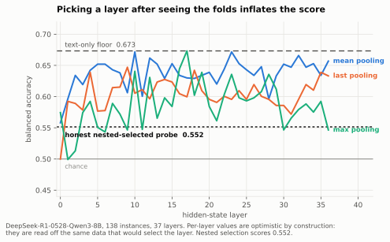
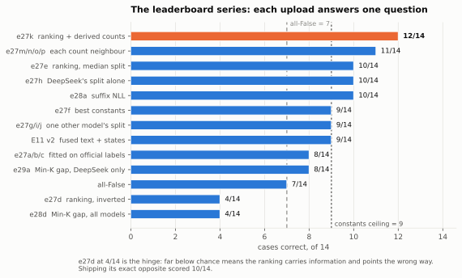
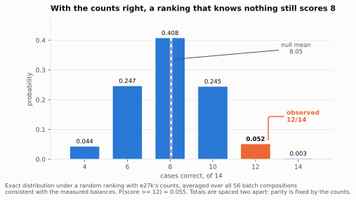
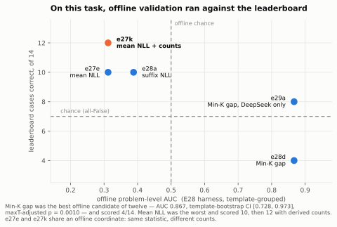

# Predicting Reasoning Robustness Without Training Data

### Four claims from the AIMO Interpretability Challenge, Small Models Track

**Farhan Ishraq**¹ · *[co-authors to be added]*

¹ Correspondence: farhanishraq2003@gmail.com · Code:
<https://github.com/farhanishraq17/AIMO-Interpretability-Challenge---Team-BakeNekos>

> **Alternative draft — 2 October 2026.** This is a restructuring of `PAPER.md`, not a replacement
> for its content. The evidence, numbers and most prose are its own; what changes is the ordering,
> the claim hierarchy, and the scope (Small Models Track only). Two numeric corrections are marked
> **[corrected]** where they appear. Findings are cited `F-n` (`PROGRESS.md`); `LF-n` marks the two
> places where a companion-track finding is used as supporting evidence.

---

## Abstract

The AIMO Interpretability Challenge asks a question that sounds like classification and is not:
given a model and a problem, will that model's answer survive perturbations that leave the
mathematics unchanged? We ran 41 experiments over six weeks on roughly 300 GPU-hours of shared
free-tier hardware. **Almost all of them failed**, and the failures are the substance of this
report: fourteen rejected hypotheses across hidden-state probes, reasoning-trace uncertainty, answer
agreement under rewriting, self-generated labels, activation geometry and contamination statistics
— each either at chance or sign-reversed when moved to an independent population.

We make four claims. **First**, what survived has no learned parameters at all: one forward pass per
problem, rank the batch by the scoring model's own mean token negative log-likelihood, call the more
familiar half robust, with the count per model fixed by a closed-form identity rather than fitted.
It scores **12/14 = 0.857** on the hidden validation set, above the 0.79 that led the board when we
started. **Second**, nothing transferred from our labelled MATH data to the olympiad distribution
the competition scores, and we can say why in a number: the lanes we closed needed 63 to 320
labelled rows and had 33 to 61, so power ran 14% to 53% and the experiments could not have returned
a positive result even had their hypotheses been true. **Third**, offline validation was
*anti-correlated* with leaderboard behaviour — the candidate with the best offline credentials
(AUC 0.867, maxT p = 0.0010) scored 4/14, while the one that failed its offline gate scored 12/14.
**Fourth**, two of the eight method families we pursued could not have been submitted at any
accuracy, missing the 3,600-second whole-run budget by 10× and 11×; the gate that catches this is
one multiplication and we never applied it.

We argued in advance that on a 14-case board where scores are multiples of 1/14, leaderboard
position would saturate; four days later three teams were tied at the top. We therefore treat
generalization, efficiency and negative results as the primary objects of study.

---

## 1. The task, and our claims

### 1.1 Formal statement

A submission implements

```
are_robust(model_id: str, problems: list[str], reasoning_effort: str = "default") -> list[bool]
```

Write `M` for the set of evaluated models and `P` for a batch of problem statements. The function
computes `f: M × P^n → {0,1}^n`, one native Python `bool` per problem, in order.

The label is **not** whether the model answers correctly. For a (model, problem) pair the organizers
generate perturbed variants in families
`Φ = {rephrase, rename, domain, distract, typos, expert_perturbations, expert_no_solution}`, each
answer-preserving except the last. With `a₀` the model's accuracy on the original and `a_φ` its
accuracy on family `φ`,

```
maxdrop(m, p) = max_{φ ∈ Φ} ( a₀(m, p) − a_φ(m, p) )
```

and the published three-valued rule (`aimo-interp/train-main-v2`, zero violations over all 82 rows,
F-30, F-33):

```
robust      iff  maxdrop ≤ 0.10
spurious    iff  maxdrop ≥ 0.25
unlabelled  otherwise            — band cases are never scored
```

Eligibility requires `a₀ = 1.0`: a model that cannot solve the original has no robustness to measure.

### 1.2 What makes it hard

**The label is a property of the problem, not the pair.** Of the 33 labelled problems in the
official split, 11 carry labels for two or more models and **all 11 agree** — every pairwise
comparison is exactly 1.000. A per-problem oracle scores 0.986 against the 71 labelled rows where
always-robust scores 0.732. An earlier measurement on a different subset found 20/20 agreement at
p = 0.0005 (F-38). The companion Main Track extends this to five models including `gpt-oss-120b`,
with the same unanimity (LF-12). So the model-specific white-box machinery the competition invites
is, empirically, aimed at variance that barely exists.

**Labels are almost absent.** The only in-population labelled data is 82 rows over 36 problems, of
which 71 carry a label. Everything else available is Hendrycks MATH, a different distribution, and
nothing transferred across that gap (§6.2). The project was label-bound from beginning to end, and
no amount of compute we had access to could fix it.

That claim is quantified in F-72 rather than asserted. For each effect we actually observed, the
rows needed to detect an effect that size at 80% power are **63, 127 and 320**; we had 33 to 61, and
power ran **14% to 53%**. The experiments were not capable of returning a positive result even if
their hypotheses were true. The converse carries equal weight and is easy to drop: an effect
estimated at n = 33 is estimated badly in *both* directions, so the honest reading is *we do not
know*, not *we were nearly right*.

**Evaluation is one hour, once.** A single RTX PRO 6000 (96 GB), 3,600 s for the *whole* run across
every model and problem, no network, no installs, weights only from a read-only cache. This is not a
training-time constraint that scale can relax; it is a hard bound on what any method may do per
problem at test time.

### 1.3 The four claims

The hidden validation set has 14 cases (F-27, F-45), so every score is a multiple of 1/14 and the
ladder from chance to ceiling has roughly seven rungs. We reached 12/14; the constants ceiling is
9/14. **We predicted the board would saturate, and within four days it did** — on 30 September the
public Small Models Track board showed three teams tied at 86%, separated only by submission
timestamp. For a fixed per-model count vector the achievable totals are spaced two apart (§6.2), so
12/14 is one rung below 14/14, a perfect ranking on every case. There is nowhere to go but perfect.

When a public board saturates, what decides the outcome is the private test set, the runtime
tie-break, and the writeup criteria — none of them leaderboard position. That is the argument for
this report's shape, and for stating what we claim up front:

1. **A training-free predictor.** One forward pass per problem, no fitted estimator, no training
   data, and per-model counts derived in closed form from a measured class balance rather than
   tuned. Its only model-specific quantity is four integers. §4, §9.
2. **Nothing transfers, and we can say how underpowered we were.** Fourteen rejected hypotheses,
   several with independent-population confirmations, and a power analysis saying the nulls are
   substantially measuring sample size — stated together with what that does *not* excuse. §6.
3. **Offline validation was anti-correlated with held-out behaviour.** The best offline candidate
   scored 4/14; the one that failed its offline gate scored 12/14. We report it as an observation,
   not a theory, and it is why we stopped selecting methods offline. §8.
4. **Two method families could never have shipped.** Costed consistently, they miss the whole-run
   budget by 10× and 11×. The gate that catches this needs no GPU, no data and no labels. §10.

---

## 2. Setting and data

### 2.1 Setting

| | |
| --- | --- |
| Competition | AIMO Interpretability Challenge, NeurIPS 2026, Fields Model Initiative |
| Scoring | Codabench competition 16180; 10 submissions/day, 300 total |
| Track | **Small Models** (open weights < 10B). A companion Main Track entry is reported separately |
| Evaluated models | `Qwen/Qwen3.5-4B`, `Skywork/Skywork-OR1-Math-7B`, `allenai/Olmo-3-7B-Think`, `deepseek-ai/DeepSeek-R1-0528-Qwen3-8B` |
| Evaluation hardware | 1× RTX PRO 6000 (Blackwell, sm_120), 96 GB, 3,600 s, offline |
| Our hardware | Kaggle free tier: T4×2, 2 sessions and 30 GPU-h per week per account, ~11 accounts shared with other projects |
| Local hardware | RTX 3050 6 GB — cannot hold any target model; data work, CPU training and packaging only |

The asymmetry between evaluation hardware and ours shaped everything. A T4×2 kernel decodes 10–90
tokens/s depending on the model, which made any generation-heavy method unaffordable to *develop*,
independently of whether it would be affordable to *run*.

### 2.2 What data exists

| Source | Content | Role |
| --- | --- | --- |
| `aimo-interp/train-main-v2` | 82 rows, 36 olympiad problems, 5 models, `maxdrop` labels | The only in-population labels |
| `aimo-interp/val-sample` | 28 public validation rows | Packaging check — 1 small-track case |
| `aimo-interp/augmented-sample-math-agg` | Hendrycks MATH, aggregated | The uncertainty baseline's training set |
| `aimo-interp-challenge-sample-full` | 10 AIME-2025 reference problems × 8 systems, and the official perturbed texts (453 variants) | Calibration exemplars |
| `aimo-interp/problems-public` | Symbolic chains | **Private; will not be shared** (F-59) |
| Our olympiad pool | 505 problems with integer answers: OlympiadBench 362, AMC 83, AIME-2024 30, AIME-2026 30 | Unlabelled; the population the test set is drawn from |

### 2.3 Three data traps, each of which cost real time

**The label rule had to be recovered, and then it changed.** Older public tables key on
`absolute_accuracy_decay`; `train-main-v2` keys on the three-valued `maxdrop` rule above. They are
different rules for different tables, and merging them corrupted two DeepSeek labels before we
noticed (F-44). The fix is a precedence rule: wherever the official split covers a pair, it decides,
and the two rules are never aggregated for the same pair.

**Problem text is not a safe grouping key.** `train-main-v2` repeats the same template with one
constant swapped — `$10^{5}$` against `$10^{4}$`, `f(3520)` against `f(2024)` — under *different*
labels: 36 distinct strings over 29 templates at similarity > 0.90 (F-34). Grouping folds by a hash
of the text leaks a near-duplicate across the split. Everything downstream groups by template.

**`AutoTokenizer` silently destroys the input.** Under transformers 5.13, loading DeepSeek's
tokenizer through `AutoTokenizer` strips all whitespace from the problem, so
`"Find the answer \boxed{204}."` round-trips to `""` (F-14). This affects the organizers' own
baseline. Every pipeline now loads through a guard that refuses a tokenizer failing a round trip,
and that guard raises `SystemExit`, which a bare `except Exception` does not catch — a detail that
would have ended an evaluation run.

### 2.4 The permission question, answered

The proposal paper forbade extra labelled data for the official perturbation types. The website
retired that restriction on 19 September, and on 26 September the organizers confirmed directly that
generating additional training data from `train-main-v2` is allowed, that the official labels are
final bar a couple of Skywork rows, and that `problems-public` is private and will never be shared
(F-59). The last point closed an entire planned lane.

---

## 3. Method

### 3.1 The predictor

Let `m` be the model being scored and `P = (p₁ … pₙ)` the batch. For each problem take **one forward
pass** over the bare problem text and record the mean token negative log-likelihood:

```
s_i = − (1/|t(p_i)|) Σ_k log P_m( t_k | t_{<k} ),      t(p_i) = tokens of p_i
```

No generation, no chat template, no system prompt, truncation at 2048 tokens (which never fires: the
longest labelled problem is 641 tokens). Rank ascending — **familiar first** — and call the first
`c_m` problems robust:

```
π = argsort(s),        ŷ_{π_j} = 1  iff  j ≤ c_m
```

### 3.2 The count, in closed form

This is the part that is derived rather than tuned, and it is the report's main methodological
result.

For model `m` on the hidden set let `r_m` and `q_m` be its robust and spurious case counts,
`n_m = r_m + q_m` its batch size, and `d_m = r_m − q_m` its **class balance**. Constant-prediction
probes measure `d_m` directly: with all-False scoring `a` cases, a probe answering `True` for model
`m` alone scores `a + d_m`, because it gains `r_m` and loses `q_m`. Measured twice, twelve days
apart (F-27, F-64):

| Model | all-False | probe | `d_m` |
| --- | --- | --- | --- |
| Qwen3.5-4B | 7/14 | 8/14 | **+1** |
| DeepSeek-R1-0528-Qwen3-8B | 7/14 | 8/14 | **+1** |
| Skywork-OR1-Math-7B | 7/14 | 6/14 | **−1** |
| Olmo-3-7B-Think | 7/14 | 6/14 | **−1** |

A ranking policy should call exactly `r_m` problems robust — any other count is wrong before the
ranking is consulted. From the definitions `r_m = (n_m + d_m)/2`. The four balances sum to 0 and the
batch sizes sum to 14, which forces **every `n_m` to be odd**, so `⌈n_m/2⌉ = (n_m+1)/2` and

```
c_m = r_m = (n_m + d_m)/2 = ⌈n_m/2⌉ + (d_m − 1)/2
```

giving the tilt as a closed form of the measured balance:

```
t_m = (d_m − 1) / 2        →   t = 0 for d = +1,   t = −1 for d = −1
```

**The per-model counts are not hyperparameters.** They are the arithmetic consequence of a
measurement, correct for *any* batch sizes consistent with it. Enumerating all 56 size assignments
consistent with the balances and the 14-case total: this rule calls exactly the true robust count in
**56 of 56**, the plain median split in **0 of 56** (F-63).

### 3.3 The algorithm, complete

```
are_robust(m, P):
    if m not in SPLIT_MODELS:        return [CONSTANT[m]] * |P|
    try:
        s   ← one forward pass per p ∈ P under model m        # no generation
        π   ← argsort(s)                                      # ascending: familiar first
        c   ← clamp( ceil(|P|/2) + t_m , 0, |P| )
        return [ j ≤ c for j in rank(π) ]
    except (Exception, SystemExit):                           # tokenizer guard raises SystemExit
        return [CONSTANT[m]] * |P|
```

`CONSTANT[m] = (d_m > 0)`, the best constant for that model. The fallback is not decoration: it is
what keeps a batch valid if weights are missing, a tokenizer fails its round-trip guard, or the
worker OOMs — and an invalid batch scores zero with no visible traceback.

### 3.4 Learned parameters: none

The shipped artifact is 3.3 KB of source and contains **no fitted estimator, no training data, no
weights**. Its only free quantities are the four balances, and those are measurements of the
evaluation distribution rather than parameters fitted to features. This is what §9 defends.

---

## 4. Experimental programme

41 experiments in seven lanes. Full registry in `experiments.md`; what follows is what each lane was
*for* and what it returned.

| Lane | Question | Experiments | Verdict |
| --- | --- | --- | --- |
| A — text | Is the problem text alone predictive? | E0, E0b | Yes on MATH (0.6732 balanced accuracy), no on olympiad |
| B — white box | Do internals carry robustness? | E1, E1b, E4, E30, E31, E32 | AUC up to 0.749 in-distribution; every controlled transfer fails |
| C — traces | Does the reasoning trace carry it? | E2, E2f, E14, E36 | At chance, and 28k tokens per problem |
| D — self-labelling | Can we make our own labels? | E7, E15–E20, E24 | κ = −0.135 on MATH, +0.286 on olympiad, neither usable |
| E — familiarity | Does contamination predict brittleness? | E12, E23, E27, E28, E29 | Fails offline gates, **wins on the leaderboard** |
| F — external | Do other robustness datasets transfer? | E34, E35, E37, E38 | Real labels found; ranking does not transfer; runtime gate fails |
| G — arithmetic | What do the leaderboard numbers force? | Probes, E40, E41 | The decisive lane, and the cheapest |

---

## 5. What failed

This section is the point of the report. Each entry states the hypothesis, the strongest result it
ever produced, and the test that killed it. The `script` column is the file that reproduces it: the
negative results are held to the same reproducibility standard as the positive one.

A negative result is only worth reading if it was strong enough to have been a positive one. The
column that matters is **"best result"** — several of these reached AUC 0.73–0.87 before the test
that rejected them, which is why they were pursued and why reporting them is not the same as
reporting things that never worked.

| # | Hypothesis | Best result it reached | What rejected it | Script | § |
| --- | --- | --- | --- | --- | --- |
| 1 | Linear probes on hidden states predict robustness | 58.37% as published; AUC 0.75–0.85 inner-fold | Nested selection gives **0.5005**; the gap is layer selection | `train_stagea_probes.py` | 5.1 |
| 2 | A model trained on MATH transfers to olympiad problems | 0.717 balanced acc in-distribution | **AUC 0.429** on olympiad rows | `eval_official_holdout.py` | 5.2 |
| 3 | Training the text block on olympiad labels instead rescues it | — | No; n = 33 is the binding limit | `eval_problem_level.py` | 5.2 |
| 4 | Self-labelling on MATH reproduces official labels | — | Cohen's **κ = −0.135**, worse than chance | `summarize_selflabels.py` | 5.3 |
| 5 | Self-labelling on *olympiad* problems does | κ = +0.286, sign flipped | CI spans 0; **~1 label per GPU-hour** | `summarize_selflabels.py` | 5.3 |
| 6 | Answer agreement under rewriting predicts robustness | — | Chance (0.507), at **28k tokens/problem** | `eval_agreement.py` | 5.4 |
| 7 | Reasoning-trace uncertainty features predict it | — | Near chance; trace states buy AUC but cost a full generation | `train_stageb_features.py`, `train_fusion.py` | 5.4 |
| 8 | Architecture-invariant activation geometry | Family-wise selected signal | **Reverses sign** on independent MATH data | `eval_e30_geometry.py` | 5.5 |
| 9 | Counterfactual prompt-state sensitivity | **AUC 0.735**, the strongest new signal found | Template CI and max-T fail; independent population gives 0.545, CI [0.428, 0.658] | `eval_e31_counterfactual.py`, `eval_e32_counterfactual_math.py` | 5.5 |
| 10 | External robustness labels support a transferring model | Real labels, 233 configurations | Putnam holdout AUC 0.609, CI [0.442, 0.769] | `eval_e35_external.py` | 5.6 |
| 11 | Budget-path reasoning diagnostics | Ranking gates passed; GSM-Plus confirmation passed | **Runtime gate**: 7,526 s for three models against a frozen 3,000 s limit | `eval_e36_budget_path.py`, `eval_e37_official.py` | 5.6 |
| 12 | Min-K tail shape, the best offline candidate of twelve | **AUC 0.867**, CI [0.728, 0.973], maxT p = 0.0010 | **4/14 on the leaderboard** | `eval_e28_stability.py` | 7 |
| 13 | Publication status explains the direction reversal | — | Both halves reverse (AUC 0.417, 0.299) instead of straddling 0.5 | `eval_familiarity.py` | 5.7 |
| 14 | The reversal survives a sharper instrument | Spearman **+0.247**, sign consistent in every model | Every CI spans zero | `eval_familiarity.py` | 5.7 |

Entry 12 is treated separately in §7, because it is the one we cannot explain.

### 5.1 The shipped baseline is at chance

The organizers' `trained-probe` solution reports 58.37% ± 7.5 on DeepSeek. Reproduced honestly under
nested cross-validation, its per-layer mean balanced accuracy is **0.5005** (F-2, F-11). The
published figure is a **layer-selection artifact**: choosing the best layer on the same data that
scores it inflates an inner-fold AUC of 0.75–0.85 down to 0.640 held out. Averaging every layer,
rather than selecting one, is a genuine lead at AUC 0.749 — but see §5.2.



**Figure 1.** Every individual layer scores well above the honestly nested probe, and several beat
the text-only floor. That gap is the artifact: per-layer values are read off the same data that would
select the layer. Nested selection — choosing the layer inside each fold — scores 0.552.
DeepSeek-R1-0528-Qwen3-8B, 138 instances, 37 layers.

**This is the single most useful thing a newcomer to this competition can know**, and it applies to
anyone who takes the baseline's number at face value.

### 5.2 Nothing transfers from MATH to olympiad problems

Our labelled data is overwhelmingly Hendrycks MATH; the private test set is entirely olympiad. Every
block was measured across that gap and every one failed (F-32, F-39, F-40):

| Block | In-distribution | On olympiad rows |
| --- | --- | --- |
| Text (char tf-idf) | 0.6732 balanced acc | AUC 0.617, CI [0.391, 0.833] spans 0.5 |
| Stage A prompt states | AUC 0.749 | AUC 0.429 |
| E11 fused, shipped | 0.717 balanced acc | AUC 0.429 |
| Cross-model probe | — | no held-out model clears chance |

Training the text block *on* olympiad labels instead does not rescue it (F-40). There is no version
of this that works at n = 33.

### 5.3 Self-labelling: two attempts, both rejected

If labels are the bottleneck, make labels. We sampled models on originals and on perturbed variants
and applied the official rule. Twice.

- **On MATH problems (E20):** Cohen's κ = **−0.135** against official labels, drops correlated
  −0.25. Worse than chance. Lane closed (F-31).
- **On olympiad problems (E24), after arguing the population was the problem:** κ = **+0.286**,
  bootstrap CI spanning 0, on 15 usable pairs — for **15.8 GPU-hours**, about one label per GPU-hour
  (F-48). The sign flipped, which is real evidence the population mattered, and the yield made the
  lane unaffordable anyway.

The deeper issue: our perturbation family (`answer_modulus`) is not one of the official seven. It
changes what is asked, so it measures a different quantity. Doing this properly needs official-style
families with verified answer preservation, which the T4 fleet cannot afford.

### 5.4 Test-time methods are unaffordable, and the signal is in the prompt

**Answer agreement under rewriting (E14).** Hypothesis: a robust model gives the same answer when the
problem is reworded. Result: balanced accuracy 0.507, AUC 0.497 — chance — at **28,000 generated
tokens per problem** (F-24). Both halves of that sentence independently disqualify it.

**Reasoning-trace uncertainty (E2f), and what trace states actually did. [corrected]** The published
14 uncertainty features are near chance on our data (F-15). Trace *states* are a more careful test
and the result is more interesting than a null. Adding them to the text + Stage A fusion moves AUC
**0.7230 → 0.7391** and balanced accuracy **0.7173 → 0.7116** (F-18) — a gain on one metric, a loss
of 0.006 on the other, with overlapping intervals. It was the first pre-declared block set whose
balanced-accuracy gain over text excluded zero.

We rejected it on **cost, not on signal**: it requires generating a full trace at inference, minutes
per problem against one forward pass. And within E4 the ordering is diagnostic — `prompt_last` scores
AUC 0.7386 while `trace_last` scores 0.6040, and the nested selector chose `prompt_last` in 4 of 5
folds. **States late in the reasoning are the weakest**, the opposite of the hypothesis E4 was built
to test. The signal is in the prompt, not in the reasoning.

*(An earlier draft of this report stated "balanced accuracy 0.7173 → 0.6928, it makes the model
worse." Both the figure and the direction were wrong. The regenerated `RESULTS.md` E4 table, run
over a different block set, gives different absolute values again; where it and `PROGRESS.md`
disagree the generated table governs.)*

### 5.5 Activation geometry: attractive, and an artifact

Two related lanes produced the project's most seductive numbers.

**E30, architecture-invariant geometry.** The family-wise test fails; the selected signal *reverses*
on independent MATH data (F-51).

**E31, counterfactual prompt-state sensitivity** — measure how far a problem's representation moves
under an answer-preserving rewrite. Best AUC **0.735** on official data, the strongest new signal we
found. It failed its template-cluster CI and its max-T test, and Qwen sat near chance (F-52). E32
then scored it on an independent DeepSeek MATH population: **AUC 0.545, CI [0.428, 0.658]** (F-53).
Lane closed.

The pattern repeats often enough to name: **a signal selected on 29 template clusters will reach
AUC 0.7–0.8 and will not survive an independent population.**

### 5.6 External datasets: labels exist, ranking does not transfer

E35 found genuine external robustness labels (MATH-Perturb as training source, Putnam-AXIOM as an
untouched holdout, 233 labelled configurations). Problem-text ranking did not transfer across the
source boundary. E36 tried the reasoning *path* at four token budgets; its ranking gates passed
strongly but its frozen absolute-threshold gate missed by 0.0025, so it formally failed. E37, the one
pre-registered confirmation, **passed its GSM-Plus confirmation and then failed its runtime gate**.
**[corrected]** The gate it failed was the protocol's frozen **3,000-second** end-to-end limit, not
the competition's 3,600 s whole-run budget: feature extraction took 5,293 s for Qwen alone and
**7,526 s for the three models that completed**, with DeepSeek's guard stopping at two hours. E38's
exact-prefix audit failed every comparison.

### 5.7 Why the last two attempts could not have worked

The direction reversal of §11 is the project's one unexplained result, and it was attacked twice more
after the rest of this section was written.

**Publication status does not explain it** (F-69). Eight of the 36 official problems appear verbatim
in our pinned olympiad pool, a publication indicator decided by text match with no reference to any
model or label. The memorisation hypothesis predicts the two halves straddle chance. They do not:
AUC **0.417** on the mirrored problems and **0.299** on the rest, both reversed, and the mirrored
half — the one that should be most memorisation-driven — is the *less* reversed of the two.

**A sharper instrument does not rescue it either** (F-70). Scored against `max_drop` directly rather
than the binarised label, familiarity correlates **+0.247**, positive in every model and every
subset, and **+0.225 within length deciles** so it is not the length artifact that drives every text
statistic here. Every interval still spans zero.

**Both results are about sample size, and we can say by how much** (F-72). Detecting a correlation of
+0.247 at 80% power needs **127 rows**; we have 37. Across the three lanes tested this way the
requirement is 63 to 320 rows against the 33 to 61 we hold, and power at the sizes actually run was
**14% to 53%**. The experiments were not capable of returning a positive result even if their
hypotheses were true, which is why the nulls in this section are so uniform.

The converse deserves equal weight and is easy to drop: low power does not make the observed effects
real. An effect estimated at n = 33 is estimated badly in *both* directions — the same arithmetic
that says we could not detect +0.247 says we could not distinguish it from +0.6 or from zero.
**The honest reading of this section is that we do not know, not that we were nearly right.**

---

## 6. What worked

### 6.1 The leaderboard series

Twenty-two submissions, each designed to answer one question rather than to climb.

| Score | | Submission | What it established |
| --- | --- | --- | --- |
| **0.86** | 12/14 | `e27k` | Ranking + derived counts. **The incumbent** |
| 0.79 | 11/14 | `e27m/n/o/p` | Every single-step neighbour of `e27k` loses exactly one case |
| 0.71 | 10/14 | `e27e` | The ranking alone, median split |
| 0.71 | 10/14 | `e27h` | DeepSeek's split alone — **the whole gain is one model's** |
| 0.71 | 10/14 | `e28a` | Suffix NLL ties: the familiarity *family* works, not one statistic |
| 0.64 | 9/14 | `e27f` | **The constants ceiling** |
| 0.64 | 9/14 | `e27g/i/j` | Splitting Qwen, Skywork or Olmo alone adds nothing |
| 0.57 | 8/14 | `e27a/b/c`, `e29a` | Offline-fitted models carry nothing |
| 0.50 | 7/14 | all-False | 7 of 14 cases are spurious |
| 0.29 | 4/14 | `e27d`, `e28d` | Far below chance ⇒ the ranking is real and inverted |

`e27d` at 4/14 is the hinge of the whole project. A score that far below chance is not noise: it says
the ranking carries information and is pointing the wrong way. Shipping its exact opposite produced
10/14 the next day.



**Figure 2.** Each upload was designed to answer one question rather than to climb. The two reference
lines are the whole strategic picture: nothing below 7 beats answering `False` everywhere, and
nothing below 9 beats the best constants, so only the top two rows contain per-problem information.

### 6.2 Why the counts were the real gain

Decomposing `e27k`'s 12: a random ranking with the *same derived counts* scores **8.05/14** in
expectation, against 7/14 for all-False (F-63). So roughly one of the two cases separating `e27k`
from `e27e` is count arithmetic, not ranking quality. The ranking's own contribution puts the
observed 12 at **p = 0.055** under a null of no ranking information — suggestive, not significant,
which is the same verdict every offline test returned, now measured on the hidden set.

| Source of the 12 | Cases | How established |
| --- | --- | --- |
| All-False floor | 7.00 | 7 of 14 cases are spurious |
| Correct per-model counts, random ranking | 8.05 | Null averaged over all 56 consistent compositions |
| Observed, with the familiarity ranking | 12 | P(score ≥ 12) = 0.055 under that null |

A structural detail worth carrying: for a fixed count vector the achievable totals are **spaced two
apart**, because parity is fixed by the sum of robust calls. `e27k` can score 10, 12 or 14 and never
11 or 13. Two cases is the minimum observable difference, not a margin.



**Figure 3.** The exact distribution of the score when the ranking is replaced by chance but the
counts are kept, averaged over all 56 batch compositions consistent with the measured balances.
Correct counts alone are worth about a case over all-False (8.05 against 7). The observed 12 sits in
the 0.052 bar: P(score ≥ 12) = 0.055.

### 6.3 Mechanical audit of the incumbent

Before freezing, we audited the shipped artifact on GPU (E39, F-62):

| | Result |
| --- | --- |
| Runtime, four models, 144 problem-scorings, 4 cold loads | **334 s** on T4×2 |
| Determinism, two identical calls | Identical for all four models |
| Cross-machine replication (separate account, session, host) | **Identical predictions on every arm** |
| fp16 vs bf16 | **0 / 36 predictions flip**, Spearman 0.993–1.000 |
| Chat template vs bare text | 2–10 / 36 flip, Spearman 0.738–0.973 |

Two conclusions. The method is **not precision-sensitive**, which matters because our features were
extracted where T4 bf16 is emulated while evaluation runs bf16 on Blackwell. And the **bare-text
prompt is load-bearing** — scoring the chat template instead is a different policy with no
leaderboard evidence, and it would move several cases. Tidying that "inconsistency" before the freeze
would have been a mistake.

---

## 7. Why offline validation misled us

The most uncomfortable result in the project, and the one we cannot explain.

| | Offline verdict | Leaderboard |
| --- | --- | --- |
| Official-label models (`e27a/b/c`) | Best available offline fit | **8/14** |
| Min-K gap (`e28d`) | Passes a *stricter* stability gate than the winner: rank AUC 0.808, worst-case omission 0.65; problem-level AUC 0.867, CI [0.728, 0.973], maxT p = 0.0010 | **4/14** |
| DeepSeek-only Min-K (`e29a`) | Controlled follow-up | **8/14** |
| Mean-NLL familiarity (`e27e`) | **Fails** gate G-M offline | **10/14** |
| The same, with derived counts (`e27k`) | Fails the same gate | **12/14** |

**On this task, offline validation was anti-correlated with leaderboard behaviour.** The two methods
with the best offline credentials scored 4/14 and 8/14; the method that failed its offline gate
scored 12/14.



**Figure 4.** Offline problem-level AUC (E28 harness, template-grouped) against cases correct on the
hidden set, for every candidate submitted with both measurements. Min-K gap was the best of twelve
candidates offline and scored 4/14. Mean NLL was among the worst offline and scored 10, then 12 once
its counts were derived. `e27e` and `e27k` share an x-coordinate: the same statistic, different
counts.

We report this as an observation rather than a theory, and we are explicit that one competition with
a 14-case validation set cannot establish a general law. What it did establish, for us, is a
decision: **we stopped selecting methods offline and started reasoning about the evaluation
distribution's arithmetic directly** (§6.2). Every subsequent gain came from that switch.

Three candidate explanations, none of which we can separate at this sample size. The offline
population — MATH-dominated, 29 template clusters — may differ from the hidden set in exactly the
direction that matters. The 14-case board has a variance floor of two cases, so single-rung
differences may not be measurable at all. Or our offline gates, deliberately strict against
overfitting, may have selected for stability rather than for transfer. Distinguishing them is open
question 4 in Appendix B.

---

## 8. Generalization

The competition rewards generalization explicitly. Our claim is narrow and, we think, defensible.

**The shipped method has nothing to overfit.** It contains no fitted estimator and no training data.
Its inputs are the scoring model's own likelihoods — available for any autoregressive model, any
tokenizer, any architecture — and four integers measured from the evaluation distribution. There is
no feature selection step, no layer choice, no threshold tuned on held-out data, because there is no
training step at all. The failure mode that killed lanes B, E-offline and F — *a signal selected on
29 clusters that reverses on an independent population* — cannot occur, because nothing is selected.

**It is architecture-agnostic by construction.** The same six lines apply unchanged to a 4B dense
model and a 117B mixture-of-experts. We verified identical behaviour across four checkpoints from
four different families (E39).

**And the model-specific surface is smaller than it looks.** The policy loads the model being scored,
which implies the ranking is model-specific information. Measured, it is almost not: across the 193
problems all four models scored, their familiarity rankings agree at mean pairwise Spearman
**0.821**, and **0.748 within length deciles** where length cannot drive it; each model sits 0.893 to
0.957 against the consensus of all four (F-68). The four models rank the same problems in
essentially the same order.

This is the same shape the robustness *label* has (§1.2): a property of the problem, not of the pair.
So the ranking generalizes for the reason problem properties do, and **the only genuinely
model-specific quantity in the method is the robust count** — four integers, measured rather than
fitted. That is a smaller surface to defend than "a per-model likelihood model," and it is the
precise sense in which this method has little to overfit.

It also implies a cheaper variant — rank once, apply per-model counts, a fourfold reduction in
test-time cost — which we did not build. It is a different policy with no leaderboard evidence, the
freeze was close, and F-62 had already shown this family moves under changes that look harmless. We
report it as an implication rather than shipping it.

**Its assumptions are stated and testable.** The method assumes (i) familiar problems are more
robust, and (ii) the per-model balances `d_m` hold. Assumption (ii) is directly measurable for five
submissions, and we re-measured it twelve days later with all four values reproducing exactly
(F-64). Assumption (i) is the contested one — see §11.

**What does not generalize, and we say so — with the size of the exposure.** The counts are measured
on the *validation* set; the prizes are scored on a private test set of 30 problems whose class prior
may differ. F-67 quantifies the cost. A policy calling `c` of `n` robust with an uninformative
ranking scores `c(2r/n − 1) + n − r`, linear in `c`, so lowering `c` by one gains `1 − 2r/n` cases:
**the crossover is a robust share of exactly 0.5, independent of batch size.**

Two consequences. Qwen and DeepSeek have zero tilt, so they contribute nothing whatever their prior
does — **the entire difference between `e27k` and `e27e` rides on two models**. And those two are the
ones our sources disagree about: the validation probes make Skywork and Olmo spurious-leaning, while
the organizers' own labelled split makes both majority robust, at 0.667 and 0.778. If the private
shares matched the official split, the tilts would cost about 0.89 cases rather than gain roughly one.

So the choice is not "0.86 against 0.71" — that compares scores on the set where `e27k` is right by
construction. It is a **symmetric bet on whether two models stay spurious-leaning**, worth about a
case either way. We ship `e27k` because the balances are the only measurement anyone has, and
measured beats assumed; `e27e` is the prior-free alternative and the right choice for anyone who
weights the official split more heavily than the validation set.

---

## 9. Efficiency, and a feasibility result

Ties break on average runtime over three repeated trials, so this is a scored axis, not a footnote.
But the stronger result here is not that our method is fast. It is that **two of the eight method
families this project pursued could not have been submitted at any accuracy.**

| Method | fwd/problem | gen tokens/problem | Total for 120 pairs | Fits 3,600 s? | Speedup needed |
| --- | --- | --- | --- | --- | --- |
| Constants / probes (`e27f`) | 0 | 0 | 0 s | yes | — |
| **Shipped (`e27k`)** | 1 | 0 | **252 s** | yes | — |
| E11 fused: text + prompt states | 1 | 0 | 252 s | yes | — |
| E28/E29 rank successors | 1 | 0 | 252 s | yes | — |
| E31/E32 counterfactual sensitivity | 5 | 0 | 1,260 s | yes | — |
| E2f trace uncertainty features | 1 | 4,096 | 5,713 s | **no** | **2×** |
| E14 test-time answer agreement | 1 | 28,000 | **37,585 s** | **no** | **10×** |
| E36/E37 budget-path diagnostics | 1 | 30,720 | **41,212 s** | **no** | **11×** |

Costed consistently over 120 pairs — the private test set's 30 problems × 4 models — at rates
measured on our own hardware: 90 generated tokens/s and 2.1 s per forward pass (F-71). The `speedup
needed` column is the assumption-free way to read it: how much faster than our hardware the method
must run to fit.

The three that fail split into two kinds, and the distinction matters. **E14 and E36/E37 miss by
10–11×.** No plausible difference between a T4 pair and one RTX PRO 6000 closes that, so they are
infeasible rather than borderline, and the verdict survives the throughput assumption being wrong by
a factor of several. **E2f misses by 2×**, which *is* within the evaluation card's plausible speedup.
It is genuinely borderline, and this table cannot settle it; calling it infeasible would overstate
what the measurement supports.

The shipped method never generates a token: it reads the problem once and returns a number. Its
measured cost is **334 s for four models and 144 problem-scorings including four cold loads** (E39),
against the 5,293 s a single rejected alternative needed for one model. The dominant cost is loading
the checkpoint, which the harness pays regardless.

**The gate, and why it matters beyond this competition.** E14 was abandoned for scoring at chance.
Had it shown signal, we would have spent the remaining weeks on something unshippable. The gate that
prevents this is one multiplication — per-pair cost must not exceed the budget divided by the pair
count, about 30 s or 2,700 generated tokens here — and it needs no GPU, no data and no labels. We
never applied it. The underlying ratio generalises past this competition: **any method that generates
pays the length of a chain of thought against the length of a problem statement, on every pair.**

---

## 10. Methodological protocol

The practices below were adopted after they were needed, and each traces to a specific loss.

**Pre-registration.** The population, procedure, metric and pass threshold are frozen in `protocols/`
before the run's output is read. Adopted after §5.1's layer-selection artifact and a threshold tuned
on the 14 cases it was then evaluated on. A gate that fails is a result.

**Template-cluster grouping, never text hashing.** §2.3.

**Independent-population confirmation.** No signal is believed on the population that selected it.
E32 exists solely to re-score E31 elsewhere, and it closed the lane.

**Every number comes from a script.** No figure is hand-typed into a document;
`scripts/regenerate_results.py` rebuilds every table in one command. This is also the competition's
reproducibility requirement.

That mechanism had a defect worth recording, because it is the failure mode of this discipline rather
than an argument against it. The rebuild starts by rewriting the file from scratch, so a section
whose producer is missing from the step list is deleted rather than left stale — and the command
still reports success. On 1 October an audit found **18 of 37 sections** in that state, accumulated
one experiment at a time by authors who upserted a section and never registered it. All 37 are now
covered, and `scripts/check_results_coverage.py` asserts the invariant and fails when a producer is
removed (F-73).

**Two-rule discipline.** The `absolute_accuracy_decay` and `maxdrop` rules are never aggregated for
the same pair (§2.3).

**Contract checks before every upload.** `coverage = 1.0`, `invalid_predictions = 0`, native `bool`s,
and the correct presence or absence of `small.txt` — a marker in the wrong place scores 0.00 and cost
four uploads to diagnose (F-21).

### 10.1 What we would do differently

1. **Read the labels before sampling anything.** Two zero-GPU analyses of 82 rows produced more
   usable structure than 120 GPU-hours of panel sampling that preceded them.
2. **Probe the evaluation distribution early.** Five constant submissions measure the class balance
   of every model, and that measurement — not any feature — is what produced our best score.
3. **Distrust any offline gate on this task** (§7).
4. **Count records, not work lists.** A completion counter that reports the work-list length rather
   than the records written will report success on a run that produced nothing.
5. **Choose a population that ships ground truth.** Perturbations preserve the answer, so grading
   needs each problem's true answer; neither the 36 official problems nor the 10 reference problems
   ship one.
6. **Budget tokens, not GPU-hours.** Every sampling failure in this project was a context-length
   failure wearing a compute-budget costume.
7. **Cost the method before testing it for signal.** Per-pair cost must not exceed the budget divided
   by the pair count — here about 30 s, or 2,700 generated tokens. One multiplication, no GPU, no
   data, and it would have rejected two of the eight method families outright (§9). We ran them for
   weeks instead.
8. **Compute the power before running the experiment, not after the null.** At 33 labelled problems,
   most of what we tested could not have reached significance at the effect sizes we hoped for
   (§5.7). Knowing that in week one would have redirected the project toward acquiring labels rather
   than testing signals against the labels we had.

---

## 11. Limitations, and the one unresolved contradiction

### 11.1 The contradiction

The shipped direction — **familiar problems are robust** — holds on DeepSeek's 142 MATH instances and
on the hidden validation set repeatedly. It **reverses** on the 34 official olympiad rows, where the
same split scores 0.353 against 0.706 for always-robust (F-58), re-confirmed with the shipped
artifact itself (F-62: agreement 0.22–0.40 against an always-robust floor of 0.67–0.78, part of which
is mechanical, since a median split cannot reproduce a 70%-robust prior).

The hypothesis we could not test: `train-main-v2` holds **published** problems — 2025 AIME I appears
verbatim — where familiarity means memorisation and predicts *spurious*; the validation cases are
mostly not those problems, where familiarity is ordinary fluency and predicts *robust*. The
organizers' own report splits results by published versus unpublished, so the distinction is theirs.

**We tested it once and it got no support** (F-69, §5.7). That is not a refutation. At n = 8 the
mirrored interval is [0.000, 0.833], and the indicator is one-sided: absence from a four-dataset pool
is not evidence of being unpublished. But the leading explanation has now been tested on the only
partition the data supports and did not separate. A clean test needs per-problem publication dates,
which nothing available to us has (F-59). **It no longer decides what we ship** — §3.2's count
argument settles `e27k` over `e27e` without reference to the ranking's direction — but it remains the
most interesting open question in the project.

### 11.2 Limitations

- **Sample size dominates everything.** Fourteen validation cases, 33 labelled problems, 82 rows.
  Power ran 14% to 53% across the lanes we closed (§5.7). Most of our negative results are
  underpowered, and we say so rather than presenting them as settled.
- **The counts are measured on the validation set, not the test set.** §8 prices the exposure: the
  tilts are a symmetric bet worth about a case either way, and they could cost 0.89 cases if the
  private class shares match the official split instead.
- **One competition is not a general law.** The offline/online inversion (§7) is a real observation on
  this task. We cannot say whether it is a property of this task, of 14-case evaluation, or of our
  own gates.
- **We did not pursue sparse autoencoders**, which the Small Models Track was designed to invite. At
  33 labelled problems a feature search over thousands of sparse features has no statistical power
  and our template-cluster bootstrap would reject anything it found. A deliberate omission, not an
  oversight.
- **The forward-pass path is verified on separate hardware, not in the competition image.** §13.1
  covers what the container check does and does not establish.

---

## 12. Related work

Every citation in this section was verified against arXiv or the publisher on 2 October 2026; full
entries with identifiers are in the References. Where a work's arXiv preprint and its venue fall in
different years, the References give both and the text uses the venue year.

**Perturbation robustness in mathematical reasoning.** The competition's premise — that final-answer
accuracy overstates reasoning — is the same one behind *GSM-Symbolic* (Mirzadeh et al., 2024), which
templates GSM8K problems and shows accuracy falling when only surface constants change, and falling
further when an irrelevant clause is added. Our `distract` family is that construction, and the
organizers' `maxdrop` rule is a thresholded version of the same measurement. *MATH-Perturb* (Huang
et al., 2025) and *Putnam-AXIOM* (Gulati et al., 2025) supply the external labels used in E35 —
both are themselves contamination-resistant benchmarks built by perturbing competition problems,
which is why their labels were the most plausible external source available. Hendrycks et al.'s
*MATH* (2021) is the distribution our labelled data came from and, per §5.2, the reason it did not
transfer.

**Contamination and membership inference.** Our shipped statistic is a membership-inference score
used for a different purpose. Mean token NLL is the oldest such signal; *Min-K%* (Shi et al., 2023)
averages the lowest-probability tokens, *Min-K%++* (Zhang et al., 2024) normalises it per token, and
the zlib-compression ratio is from Carlini et al.'s training-data extraction work (2021), with
reference-model calibration from *Membership Inference Attacks From First Principles* (Carlini et
al., 2022). We implemented all of them (E23, E28). The relevant negative result is §7: the statistic
with the strongest contamination-detection credentials offline was the worst predictor of robustness
on the hidden set, and plain mean NLL was the best.

To our knowledge the *direction* we found — familiar problems being **more** robust on the evaluation
distribution, while familiarity predicts brittleness on published olympiad problems (§11) — is not
reported in that literature, which studies contamination as a threat to benchmark validity rather
than as a feature.

**Probing and its selection artifacts.** Linear probing of hidden states follows Alain and Bengio
(2016); Hewitt and Liang's *Designing and Interpreting Probes with Control Tasks* (2019) is the
direct antecedent of §5.1 — a probe's accuracy is uninterpretable without a control for what the
probe itself can fit. Belinkov's probing survey (2022) catalogues the same failure. Our contribution
here is an instance rather than a method: the competition's own published baseline reports 58.37%
where honest nested selection gives 0.5005, and the difference is layer selection.

**Sparse autoencoders.** Feature-level interpretability via SAEs (Cunningham et al., 2023; Bricken et
al., 2023; Templeton et al., 2024) is what the Small Models Track was designed to invite. We did not
pursue it, for the reason given in §11.2.

**Uncertainty and self-consistency.** The organizers' second baseline uses token-level uncertainty
features; the underlying idea traces to Kadavath et al. (2022) on models knowing what they know, and
to semantic-entropy approaches (Kuhn et al., 2023; Farquhar et al., 2024). Self-consistency (Wang et
al., 2023) motivated E14's answer-agreement test. Both were at chance here (§5.4), and E14's cost —
28,000 generated tokens per problem — is the concrete reason sampling-based uncertainty is a poor fit
for a one-hour whole-run budget.

**Multiple comparisons.** The maxT family-wise adjustment used throughout our gates follows Westfall
and Young's resampling-based procedure (1993). Applying it is what turned several attractive signals
into null results (§5.5).

**Where this work sits.** We contribute no new interpretability *technique*, and that is not the
claim. The claim is methodological and it is unfavourable to the field's usual practice: on this
task, a predictor with no fitted parameters beat every fitted one we built, and the offline metrics
interpretability research routinely selects on were *anti-correlated* with held-out performance (§7).
Both are statements about how interpretability methods should be validated, not about a new way to
read a model.

---

## 13. Reproducibility

```bash
# Every generated table in the Small Models Track (~25 min)
python scripts/regenerate_results.py

# The leaderboard arithmetic and the null test for 12/14
python train/eval_batch_composition.py

# Rebuild every submission ZIP, deterministically
python submission/make_e27.py     # 13 candidates incl. the incumbent
python submission/make_e28.py     # rank successors
python submission/make_probes.py  # the 5 constant probes
```

Repository layout: `CLAUDE.md` (conventions), `COMPETITION.md` (rules), `PLAN.md`, `PROGRESS.md`
(numbered findings), `RESULTS.md` (generated — never hand-edited), `experiments.md` (registry) and
`protocols/` (pre-registrations). Submissions are indexed by score in `submission/README.md`, and the
built ZIPs are committed, so the artifact that scored can be uploaded from a clone without
rebuilding. Kernels are exported to `kernels/` exactly as pushed, so any run can be rebuilt if a
Kaggle account disappears. Every rejected lane in §5 names the script that reproduces it.

### 13.1 The shipped artifact, verified in the competition image

The organizers must be able to reproduce the result from this report alone, so the shipped ZIP was
run inside `Dockerfile.competition` itself, with networking disabled (E42, F-65, F-66).

The first run **failed, and both failures were in our test harness rather than the submission** — an
exact-match comparison against `torch.__version__` that could never succeed on a CUDA wheel reporting
`2.12.1+cu132`, and a `small.txt` check that was computed and reported but left out of the pass
expression. Both are fixed. We record this because it is the honest version of a reproducibility
claim: the first independent execution of our own check found bugs in the check.

The corrected script then passed end to end on a **second machine**, from an image rebuilt with
`--no-cache`, exit code 0. The result is committed as `submission/docker_load_test_result.json` with
the provenance that makes it checkable rather than assertable:

| Field | Value |
| --- | --- |
| Base image digest | `sha256:f48553a2…` (as pinned in `Dockerfile.competition`) |
| Dockerfile from submodule | `995f9923…` |
| SHA-256 of the tested ZIP | `b79addef…` — matches `dist/solution-e27k-tilted-small.zip` |
| SHA-256 of the test script | `edb6c8c5…` — matches `submission/docker_load_test.py` |
| Result | `PASS`, all nine pinned versions matched, exit 0 |

The two hashes are the point: they establish that the artifact tested is byte-identical to the one in
this repository, not a locally patched copy. What this does **not** cover is the forward-pass path,
which needs cached weights and a GPU — that is E39, on separate hardware, where predictions were
identical across two machines.

---

## 14. Contributions

Four claims, in the order the report makes them.

**1. A training-free robustness predictor, with its only free parameters derived rather than tuned.**
It scores 12/14 on the hidden validation set by ranking a batch on the scoring model's own
likelihoods and fixing each model's robust count by a closed-form identity in the measured class
balance (§3.2). The rule calls the exactly correct count in 56 of 56 batch compositions consistent
with the measurement, where the plain median split does so in 0 of 56. Supporting this:

- a **leaderboard-arithmetic method** for extracting the evaluation distribution's per-model class
  balance from constant submissions, and for testing whether an observed score exceeds what those
  counts alone explain (§6.2);
- the structural result that the **familiarity signal is a property of the problem, not the pair** —
  four models agree at Spearman 0.821 — so the only model-specific quantity in the method is four
  measured integers (§8).

**2. Fourteen documented negative results, with the power analysis that says what they do and do not
establish.** Several carry independent-population confirmations, and several reached AUC 0.73–0.87
before the test that rejected them (§5). The lanes we closed needed 63 to 320 labelled rows and had
33 to 61, so power ran 14% to 53% and the experiments could not have returned a positive result even
had their hypotheses been true. **We state the converse with equal weight: this does not make the
observed effects real.** Supporting this: a **correction to the organizers' published baseline**,
whose 58.37% is a layer-selection artifact that honest nested cross-validation puts at 0.5005 (§5.1).

**3. A measured inversion between offline validation and held-out behaviour.** The candidate with the
best offline credentials — AUC 0.867, CI [0.728, 0.973], maxT p = 0.0010 — scored 4/14, while the one
that failed its offline gate scored 12/14 (§7). We report it as an observation, not a theory, and it
is the reason we stopped selecting methods offline and began reasoning about the evaluation
distribution's arithmetic directly. Every subsequent gain came from that switch.

**4. A feasibility result about the task's compute budget.** Two of the eight method families we
pursued could not have been submitted at any accuracy, missing the 3,600-second whole-run budget by
10× and 11× (§9). The gate that catches this is one multiplication — per-pair cost against budget
divided by pair count — and it needs no GPU, no data and no labels. We never applied it. The
underlying ratio is general: any method that generates pays the length of a chain of thought against
the length of a problem statement, on every pair.

**Further findings.** A **tokenizer defect** in transformers 5.13 that silently empties DeepSeek's
input and affects the organizers' own baseline (§2.3); and the observation that `reasoning_effort`
almost never changes the label, measured in the companion track (LF-13).

---

## References

All twenty entries were checked against arXiv or the publisher on **2 October 2026**; none was taken
on trust from an earlier draft, and none was dropped. Where the arXiv preprint and the peer-reviewed
venue fall in different years, both are given.

### Perturbation robustness in mathematical reasoning

1. Mirzadeh, I., Alizadeh, K., Shahrokhi, H., Tuzel, O., Bengio, S., Farajtabar, M. *GSM-Symbolic:
   Understanding the Limitations of Mathematical Reasoning in Large Language Models.* arXiv:2410.05229, 2024.
2. Hendrycks, D., Burns, C., Kadavath, S., Arora, A., Basart, S., Tang, E., Song, D., Steinhardt, J.
   *Measuring Mathematical Problem Solving With the MATH Dataset.* arXiv:2103.03874, 2021.
3. Huang, K., Guo, J., Li, Z., Ji, X., Ge, J., Li, W., Guo, Y., Cai, T., Yuan, H., Wang, R., Wu, Y.,
   Yin, M., Tang, S., Huang, Y., Jin, C., Chen, X., Zhang, C., Wang, M. *MATH-Perturb: Benchmarking
   LLMs' Math Reasoning Abilities against Hard Perturbations.* arXiv:2502.06453, 2025.
4. Gulati, A., Miranda, B., Chen, E., Xia, E., Fronsdal, K., Dumont, B., Obbad, E., Koyejo, S.
   *Putnam-AXIOM: A Functional and Static Benchmark for Measuring Higher Level Mathematical
   Reasoning in LLMs.* arXiv:2508.08292, 2025.
5. He, C., Luo, R., Bai, Y., Hu, S., Thai, Z. L., Shen, J., Hu, J., Han, X., Huang, Y., Zhang, Y.,
   Liu, J., Qi, L., Liu, Z., Sun, M. *OlympiadBench: A Challenging Benchmark for Promoting AGI with
   Olympiad-Level Bilingual Multimodal Scientific Problems.* arXiv:2402.14008, 2024.

### Contamination and membership inference

6. Shi, W., Ajith, A., Xia, M., Huang, Y., Liu, D., Blevins, T., Chen, D., Zettlemoyer, L.
   *Detecting Pretraining Data from Large Language Models.* arXiv:2310.16789, 2023. — introduces Min-K%.
7. Zhang, J., Sun, J., Yeats, E., Ouyang, Y., Kuo, M., Zhang, J., Yang, H. F., Li, H. *Min-K%++:
   Improved Baseline for Detecting Pre-Training Data from Large Language Models.* arXiv:2404.02936, 2024.
8. Carlini, N., Tramer, F., Wallace, E., Jagielski, M., Herbert-Voss, A., Lee, K., Roberts, A.,
   Brown, T., Song, D., Erlingsson, U., Oprea, A., Raffel, C. *Extracting Training Data from Large
   Language Models.* arXiv:2012.07805, 2020; USENIX Security, 2021. — the zlib-ratio baseline.
9. Carlini, N., Chien, S., Nasr, M., Song, S., Terzis, A., Tramer, F. *Membership Inference Attacks
   From First Principles.* arXiv:2112.03570, 2021; IEEE S&P, 2022. — reference-model calibration.

### Probing and its selection artifacts

10. Alain, G., Bengio, Y. *Understanding intermediate layers using linear classifier probes.*
    arXiv:1610.01644, 2016.
11. Hewitt, J., Liang, P. *Designing and Interpreting Probes with Control Tasks.* arXiv:1909.03368, 2019.
12. Belinkov, Y. *Probing Classifiers: Promises, Shortcomings, and Advances.* arXiv:2102.12452, 2021;
    *Computational Linguistics*, 2022.

### Sparse autoencoders

13. Cunningham, H., Ewart, A., Riggs, L., Huben, R., Sharkey, L. *Sparse Autoencoders Find Highly
    Interpretable Features in Language Models.* arXiv:2309.08600, 2023.
14. Bricken, T., et al. *Towards Monosemanticity: Decomposing Language Models with Dictionary
    Learning.* Transformer Circuits Thread, Anthropic, 2023.
15. Templeton, A., et al. *Scaling Monosemanticity: Extracting Interpretable Features from Claude 3
    Sonnet.* Transformer Circuits Thread, Anthropic, 2024.

### Uncertainty, calibration and self-consistency

16. Kadavath, S., Conerly, T., Askell, A., Henighan, T., Drain, D., Perez, E., Schiefer, N., et al.
    *Language Models (Mostly) Know What They Know.* arXiv:2207.05221, 2022.
17. Kuhn, L., Gal, Y., Farquhar, S. *Semantic Uncertainty: Linguistic Invariances for Uncertainty
    Estimation in Natural Language Generation.* arXiv:2302.09664, 2023; ICLR 2023 (spotlight).
18. Farquhar, S., Kossen, J., Kuhn, L., Gal, Y. *Detecting hallucinations in large language models
    using semantic entropy.* *Nature* **630**(8017), 625–630, 2024.
19. Wang, X., Wei, J., Schuurmans, D., Le, Q., Chi, E., Narang, S., Chowdhery, A., Zhou, D.
    *Self-Consistency Improves Chain of Thought Reasoning in Language Models.* arXiv:2203.11171,
    2022; ICLR 2023.

### Statistics

20. Westfall, P. H., Young, S. S. *Resampling-Based Multiple Testing: Examples and Methods for
    p-Value Adjustment.* Wiley, 1993. — the maxT procedure.

### Competition sources

21. AIMO Interpretability Challenge. <https://aimo-interp.github.io/>
22. Štefánik, M., Mondorf, P., et al. *AIMO Interpretability Challenge.* arXiv:2607.13899. — the
    proposal paper.
23. Starter kit. <https://github.com/aimo-interp/getting-started>, submodule pinned at `995f9923`.
24. `aimo-interp/train-main-v2`, revision `23791d9b` — the 82 labelled rows.
25. Codabench competition 16180 — the leaderboard and scoring programs.

---

## Appendix A — Experiment index

`experiments.md` carries the full registry with configuration and outcome for all 41 experiments.
`PROGRESS.md` carries findings F-1…F-73 with the evidence for each. `RESULTS.md` carries 37 generated
metric tables, each with the command that rebuilds it.

## Appendix B — Open questions

1. Does familiarity predict robustness differently for published and unpublished problems (§11.1)?
2. Does the per-problem invariance hold at n ≈ 500, or is it an artifact of the three-valued rule
   discarding the ambiguous band?
3. Can official-family perturbations with verified answer preservation reproduce the organizers'
   labels? This is the gate that would reopen supervised work.
4. Is the offline/online inversion (§7) a property of this task, of 14-case evaluation, or of our
   offline gates?
